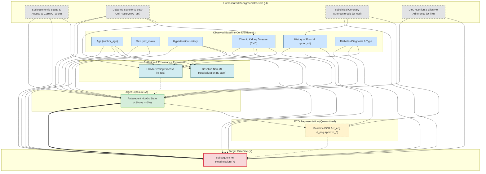

# Candidate Causal Framework: Antecedent HbA1c and Subsequent Myocardial Infarction

> **CRITICAL SCIENTIFIC STATUS:**  
> **Candidate DAG — NOT YET EXPERT VALIDATED**  
> This document specifies a candidate causal framework for the clinical-risk-factor branch. It is prepared for clinical and methodological expert review. In accordance with project safeguards, **no causal effects (ATE/CATE) are estimated, no automated causal discovery algorithms have been executed, and no adjustment sets are finalized.**

---

## 1. Executive Summary & Purpose

This document transitions the myocardial infarction (MI) project from the completed data and timing audit phase into the **Causal Design Phase**. 

The completed baseline-window audit (`CLINICAL_BASELINE_WINDOW_AUDIT.md`) demonstrated that antecedent laboratory recovery is technically valid (no post-baseline leakage, no same-day timing ambiguity, finite numeric values), but identified limited near-term coverage and high proportions of unlinked encounter provenance across all candidate biomarkers. Among all investigated candidates, **Hemoglobin A1c (HbA1c)** emerged as the leading biological candidate because:
1. It reflects a biologically stable, time-integrated glycemic state over the preceding 8–12 weeks (erythrocyte lifespan), unlike volatile acute stress markers (e.g., routine blood glucose, BUN, or acute creatinine).
2. It has established c\
linical targets (ADA guidelines) that guide preventive cardiology and diabetology.
3. Within the diabetic cohort, it exhibits sufficient empirical support and a well-balanced distribution across standard clinical thresholds.

The purpose of this framework is to define a scientifically defensible target causal trial, delineate the causal DAG, classify candidate variable roles, address the fundamental consistency problem, and specify the exact clinical decisions required for expert validation before any statistical estimation occurs.

---

## 2. Empirical Verification in the Project Data (Step 1)

Using the recovered longitudinal files (`admissions_chronology.parquet`, `diagnoses_all.parquet`, `mi_admissions.parquet`, `observation_end.parquet`) and the timing audit extract (`clinical_factor_timing_audit.parquet`), we verified the data foundation for HbA1c specifically within the diabetic population.

### 2.1 Cohort & Diabetes Prevalence
- **Total longitudinal cohort:** 180,733 unique patients across 431,231 hospital admissions.
- **Candidate baseline cohort (earliest non-MI admission per patient):** 174,055 unique patients/admissions.
- **Patients with established diabetes on or before baseline admission:** **29,909** patients (17.18% of the candidate baseline cohort).
- **Patients ever diagnosed with diabetes in the database:** 36,561 patients.
- **ECG-linked master subset (Phase F):** 14,164 diabetic patients (prevalence 22.56%).

### 2.2 Antecedent HbA1c Coverage Among Diabetic Patients
In `CLINICAL_BASELINE_WINDOW_AUDIT.md`, coverage was reported against all 174,055 general baseline admissions (3.49% at 30d to 11.69% at 365d). When restricted to the clinically relevant target population (**patients with diabetes**), antecedent testing coverage increases substantially:

| Antecedent Window | Diabetic Patients Measured | Diabetic Coverage (%) | Unlinked Encounter Provenance (`hadm_id` null) | Median Value [%] [IQR] | Later MI Readmissions ($n$, %) |
|:---|---:|---:|---:|:---:|---:|
| **30-day window** | 2,653 / 29,909 | 8.87% | 93.71% (2,486) | 7.00 [6.30, 8.10] | 253 (9.54%) |
| **90-day window** | 4,818 / 29,909 | 16.11% | 94.23% (4,540) | 7.00 [6.30, 8.10] | 534 (11.08%) |
| **180-day window** | 6,575 / 29,909 | 21.98% | 95.12% (6,254) | 7.00 [6.30, 8.00] | 763 (11.60%) |
| **365-day window** | 8,042 / 29,909 | 26.89% | 95.29% (7,663) | 6.90 [6.30, 8.00] | 949 (11.80%) |

### 2.3 Value Distribution Across Clinical Thresholds
Among diabetic patients with an antecedent measurement, the distribution demonstrates natural, empirical balance across guideline-recommended cutoffs:
- **HbA1c < 7.0% (Clinically Controlled / Standard Target):** 48.0% (30d) to 50.2% (365d).
- **HbA1c 7.0% – 7.9% (Intermediate / Relaxed Target):** 23.9% (90d) to 24.5% (30d).
- **HbA1c $\ge$ 8.0% (Above-Target / Poorly Controlled):** 25.9% (365d) to 27.6% (30d).
- **Observed Range:** Minimum 4.3% – 4.6%, Maximum 18.2%. No non-finite or non-numeric values.

### 2.4 Empirical Practical Feasibility
With **4,818 to 8,042** diabetic patients and **534 to 949** subsequent MI events under the 90d to 365d windows, sample size and event counts are fully sufficient for causal estimation once identification and adjustment conditions are formally specified.

---

## 3. Temporal Outcome Evaluation: Index Admission vs. Subsequent MI (Step 2)

A crucial architectural decision in causal design is establishing **Time Zero ($t_0$)** and the definition of the outcome $Y$. We evaluated two competing paradigms:

### Paradigm A: Antecedent HbA1c $\to$ MI During the Index Admission
- **Structure:** Antecedent HbA1c measured in $[t_{\text{adm}} - W, t_{\text{adm}}) \to$ MI occurring during the current admission (`is_MI` = True).
- **Evaluation:** **SCIENTIFICALLY FLAWED & REJECTED.**
  1. *Conditioning on a Collider (Berkson's Bias):* The study population consists solely of individuals admitted to the hospital at $t_{\text{adm}}$. Hospital admission is an acute event precipitated by symptoms, acute decompensation, or emergency presentation. Conditioning on hospitalization creates collider stratification bias between HbA1c, comorbidities, and unmeasured frailty.
  2. *Reverse Causality / Event Inception:* An admission resulting in an MI diagnosis was overwhelmingly precipitated by the acute coronary event itself. Patients present to the emergency department *with* an acute plaque rupture or evolving infarction; the diagnostic troponin (`index_mi_time`) charted hours later in the hospital is an ascertainment marker, not the biological start of the event.
  3. *Ill-Defined Time Zero:* If $t_0$ is the admission date, the event has already started. If $t_0$ is the HbA1c charttime months prior, conditioning on being admitted at $t_{\text{adm}}$ introduces severe immortal time bias.

### Paradigm B: Antecedent HbA1c $\to$ Subsequent MI in a Later, Separate Admission
- **Structure:** Antecedent HbA1c measured in $[t_0 - W, t_0) \to$ Baseline non-MI discharge at $t_0 \to$ Prospective follow-up $\to$ Incident MI-coded hospital admission at $t_{\text{MI}} > t_0$.
- **Evaluation:** **SCIENTIFICALLY PREFERABLE & ADOPTED.**
  1. *Strict Temporal Separation:* $t_{\text{lab}} < t_0 < t_{\text{MI}}$. The biomarker measurement unambiguously precedes the start of follow-up, and follow-up unambiguously precedes the outcome.
  2. *True Longitudinal Target Trial:* Emulates a prospective cohort where diabetic patients with documented glycemic control are followed forward in time for incident cardiovascular events.
  3. *Immunity to Index Presentation Contamination:* Excluding baseline MI admissions ensures that baseline HbA1c is not an acute stress artifact or post-MI measurement.

---

## 4. Defining the Causal Question & The Consistency Problem (Step 3)

### 4.1 The Consistency Problem: Biomarker State vs. Clinical Treatment
In causal inference, potential outcomes ($Y^a$) require the **consistency assumption**: if an individual has exposure $A = a$, then their observed outcome $Y$ equals $Y^a$. This assumption is valid only when the intervention $a$ is sufficiently well-defined.

> [!WARNING]
> **HbA1c is a biological state, NOT an active treatment.**
> An HbA1c value of 6.8% can arise from vastly different biological and clinical mechanisms:
> - Mild early-stage diabetes managed solely by lifestyle and nutrition.
> - Treatment with SGLT2 inhibitors or GLP-1 receptor agonists, which confer direct pleiotropic cardioprotection independent of glucose lowering.
> - High-dose sulfonylureas or insulin with frequent subclinical hypoglycemia (which induces sympathetic activation, cardiac arrhythmias, and vascular stress).
> - Altered erythrocyte turnover, hemoglobinopathy, or occult blood loss.
>
> Conversely, an HbA1c of 8.5% can reflect severe insulin resistance, advanced beta-cell exhaustion, medication non-adherence due to social determinants of health, or clinical inertia.

Therefore, this analysis **must not be described as "the causal effect of diabetes medications" or "the effect of lowering glucose by drug X."**

### 4.2 Candidate Framing Options
1. **Biomarker State / Target Achievement Contrast (Recommended for Candidate Trial):**
   - Contrasts the potential outcome if a patient is in a controlled glycemic state ($HbA1c < 7.0\%$) versus an above-target state ($HbA1c \ge 7.0\%$).
   - *Identification Assumption:* Assumes that within strata of observed confounders, the distribution of treatment versions (lifestyle vs. metformin vs. insulin) in each exposure group is stable and representative of routine clinical practice.
2. **Dynamic Treat-to-Target Strategy:**
   - Evaluates a protocolized management strategy (e.g., "intensify medication whenever HbA1c exceeds 7.0%").
   - *Limitation in Current Data:* Requires complete longitudinal outpatient medication adherence and prescribing records, which are partially unlinked or unavailable in MIMIC-IV.
3. **Continuous Glycemic Dose-Response:**
   - Evaluates the effect per 1.0% change in HbA1c across the continuum.
   - *Limitation:* Extrapolates across non-linear biological regimes (e.g., severe hypoglycemia risk at HbA1c < 6.0% vs. hyperosmolar toxicity at > 10.0%) and further stretches the consistency assumption.

### 4.3 Candidate Clinical Thresholds
- **Primary Candidate: 7.0% (53 mmol/mol):** Standard American Diabetes Association (ADA) target for non-pregnant adults.
- **Secondary Candidate: 8.0% (64 mmol/mol):** ADA/KDIGO guideline-endorsed relaxed target for older adults, patients with extensive comorbidities (CKD, heart failure), or high hypoglycemia vulnerability.
- *Clinical Expert Validation Requirement:* The clinical expert must confirm whether a uniform 7.0% threshold is appropriate, or whether a stratified analysis by age/CKD using 8.0% is clinically essential.

---

## 5. Candidate Overall Causal DAG (Step 4)

Below is the candidate Directed Acyclic Graph (DAG) for the relationship between antecedent HbA1c state and subsequent MI risk.

---

## 6. Detailed Explanation of Important DAG Edges

### 6.1 Known / Strong Clinical Relationships (Solid High-Confidence Edges)
1. **Age $\to$ HbA1c & Age $\to$ Subsequent MI:** Aging is associated with progressive pancreatic beta-cell dysfunction, altered insulin sensitivity, and higher arterial stiffness. Age is independently one of the strongest predictors of coronary plaque rupture and acute MI.
2. **Sex $\to$ Subsequent MI:** Male sex is an established strong risk factor for earlier onset and higher incidence of obstructive coronary artery disease and myocardial infarction.
3. **Hypertension $\to$ Subsequent MI:** Sustained elevated blood pressure causes endothelial shear stress, coronary vascular remodeling, accelerated atherogenesis, and increased myocardial oxygen demand.
4. **Prior MI $\to$ Subsequent MI:** Patients with prior myocardial infarction have established, severe coronary artery disease, altered ventricular geometry, and an order-of-magnitude higher rate of recurrent ischemic events.
5. **CKD $\to$ Subsequent MI:** Chronic kidney disease accelerates vascular calcification, secondary hyperparathyroidism, chronic volume overload, and coronary plaque vulnerability.
6. **Diabetes Type/Duration $\to$ HbA1c:** Longer duration and type of diabetes directly dictate the loss of endogenous insulin secretion and the difficulty of glycemic management.
7. **HbA1c $\to$ Subsequent MI (Target Causal Edge):** Sustained chronic hyperglycemia induces advanced glycation end-products (AGEs), oxidative stress, systemic vascular inflammation, impaired fibrinolysis, and coronary microvascular dysfunction, contributing causally to atherosclerotic plaque vulnerability and thrombosis.

### 6.2 Plausible but Uncertain Relationships (Requires Methodological/Clinical Attention)
1. **CKD $\to$ HbA1c:** CKD alters red blood cell survival, induces subclinical hemolysis, and often involves treatment with erythropoietin-stimulating agents or iron, which can artificially shift HbA1c measurements independently of true ambient glycemia. Furthermore, impaired renal clearance of insulin increases hypoglycemia vulnerability, leading clinicians to intentionally relax glycemic targets.
2. **Prior MI $\to$ HbA1c:** Patients with known cardiovascular disease are treated under different clinical guidelines where aggressive glycemic lowering (tight control) is often de-emphasized to prevent arrhythmia-inducing hypoglycemic episodes.
3. **Selection into Testing ($R_{\text{test}}$) $\to$ Observed HbA1c:** Testing is not random. Patients who have an outpatient or antecedent HbA1c drawn are actively engaged with the healthcare system, have established primary care, or exhibit overt metabolic symptoms prompting testing.

### 6.3 Unresolved Relationships Requiring Expert Adjudication
1. **Unmeasured Confounders ($U_{\text{socio}}, U_{\text{dm\_sev}}, U_{\text{lifestyle}}$) $\to$ HbA1c and MI:** How completely can observed baseline comorbidities (HTN, CKD, Age, Sex, Prior MI) proxy for underlying disease severity and health behaviors?
2. **Outpatient Medication Regimens as Confounders:** Medications such as SGLT2 inhibitors and GLP-1 receptor agonists directly lower MI risk while lowering HbA1c. Conversely, high-dose insulin may indicate severe end-stage diabetes. Because outpatient prescription fill history is largely unlinked in MIMIC-IV, the degree of unmeasured confounding by antidiabetic regimen must be evaluated by the clinical expert.

---

## 7. Explicit Evaluation of ECG Features and $z_{\text{ECG}}$

A critical directive of this design phase is to resolve whether engineered ECG features and the 64-dimensional latent embedding block ($z_{\text{ecg}}$) belong in the adjustment set.

> [!IMPORTANT]
> **ECG and $z_{\text{ecg}}$ MUST BE QUARANTINED FROM THE ADJUSTMENT SET.**  
> They are **NOT** pre-exposure confounders. Placing them in the adjustment set would induce severe bias.

### Why ECG Variables Cannot Be Confounders:
1. **Temporal Sequence:**  
   In the longitudinal design, the candidate exposure is an **antecedent** HbA1c measured weeks to months *prior* to baseline admission ($t_{\text{lab}} < t_0$). The baseline ECG is recorded at hospital presentation ($t_{\text{ecg}} \approx t_0$). Therefore:
   $$\text{Antecedent HbA1c } (t_{\text{lab}}) \longrightarrow \text{Baseline ECG } (t_{\text{ecg}}) \longrightarrow \text{Subsequent MI } (t_{\text{MI}})$$
2. **ECG as a Downstream Descendant / Mediator:**  
   Months of chronic hyperglycemia directly affect cardiac electrophysiology, causing repolarization abnormalities (prolonged QTc, ST-T wave changes), microvascular ischemia, and diabetic cardiomyopathy (left ventricular hypertrophy). An ECG recorded at baseline reflects these intermediate structural and electrical changes.  
   *Adjusting for a mediator when targeting the total causal effect blocks the causal pathway, creating **overcontrolling bias**.*
3. **ECG as a Potential Collider:**  
   Baseline ECG features are simultaneously driven by antecedent metabolic state ($HbA1c$) and pre-existing subclinical coronary disease ($U_{\text{cad}}$). Conditioning on an intermediate ECG node opens a non-causal spurious pathway between HbA1c and unmeasured cardiovascular pathology:
   $$HbA1c \longrightarrow \boxed{ECG} \longleftarrow U_{\text{cad}} \longrightarrow \text{Subsequent MI}$$
   This induces **collider stratification bias**.
4. **Conclusion:**  
   All 95 engineered ECG features and all 64 $z_{\text{ecg}}$ latent dimensions remain **quarantined**. They may only be studied in downstream secondary mediation analyses, never as baseline confounders.

---

## 8. Variable Role Classification Table (Step 5)

| Variable Name / Block | Source / Column | Temporal Position | Causal Role | Rationale & Handling |
|:---|:---|:---|:---|:---|
| **Antecedent HbA1c** | `clinical_factor_timing_audit.parquet` (50852) | Lookback window $[t_0 - W, t_0)$ | **Primary Exposure ($A$)** | Target exposure representing antecedent glycemic control state. Evaluated at candidate thresholds (< 7% vs $\ge$ 7%). |
| **Subsequent MI Admission** | `mi_admissions.parquet` | $t_{\text{MI}} > t_0$ (follow-up) | **Primary Outcome ($Y$)** | Incident acute myocardial infarction admission occurring strictly during prospective post-baseline follow-up. |
| **Age** | `anchor_age` | Baseline ($t_0$) | **Confounder ($L$)** | Strong cause of both metabolic dysregulation and coronary event risk. Include in candidate adjustment. |
| **Sex** | `sex_male` | Baseline ($t_0$) | **Confounder ($L$)** | Strong determinant of baseline cardiovascular risk and glycemic pathophysiology. Include in candidate adjustment. |
| **Hypertension** | `hypertension` flag | On/before $t_0$ | **Confounder ($L$)** | Major shared vascular risk factor influencing treatment goals and MI hazard. Include in candidate adjustment. |
| **Chronic Kidney Disease** | `ckd` flag | On/before $t_0$ | **Confounder / Effect Modifier ($L$)** | Alters HbA1c interpretation, drives clinical target relaxation (< 8%), and massively increases CV risk. Candidate stratum / confounder. |
| **Prior MI History** | `prior_mi` / `mi_admissions` | Strictly $< t_0$ | **Confounder / Effect Modifier ($L$)** | Differentiates secondary prevention from primary prevention. Crucial baseline confounder. |
| **Diabetes Diagnosis** | `diagnoses_all.parquet` (ICD-9 250*, ICD-10 E08-E13) | On/before $t_0$ | **Population Eligibility / Subgroup** | Restricts study population to individuals with clinically diagnosed diabetes mellitus. |
| **Antidiabetic Medications** | Unlinked / partly missing | Prior to $t_0$ | **Unmeasured Confounder / Treatment Version** | Dictates HbA1c and modulates CV risk. Absence in outpatient records is a primary unmeasured confounding concern. |
| **Statin / CV Medications** | Master `*_before` indicators | Prior to $t_0$ | **Candidate Confounder (Uncertain)** | Co-treatments. Provenance and timing must be established before inclusion. |
| **Engineered ECG Features** | Master (95 features) | At baseline ($t_{\text{ecg}} \approx t_0$) | **Mediator / Collider (QUARANTINED)** | Measured *after* antecedent HbA1c. Adjusting causes overcontrolling or collider bias. Exclude from adjustment set. |
| **$z_{\text{ecg}}$ Latent Block** | Master (`z_ecg_1` ... `z_ecg_64`) | At baseline ($t_{\text{ecg}} \approx t_0$) | **Mediator / Collider (QUARANTINED)** | Latent representation of cardiac electrophysiology at baseline. Exclude from adjustment set. |
| **`index_mi_time`** | Master | Linked to MI event | **Outcome Ascertainment Metadata** | Charttime of diagnostic troponin. Must NEVER be used as a baseline exposure or covariate. |
| **`Label_Troponin` / `is_MI`** | Master | Baseline stay | **Index Stay Metadata (Excluded)** | Not applicable to prospective subsequent MI outcome. |
| **Testing Indicator ($R_{\text{test}}$)**| Derived missingness | Antecedent | **Selection Node** | Dictates availability of lab measurement. Addressed via inverse probability weighting or target population definition. |
| **Baseline Admission ($S_{\text{adm}}$)**| `admissions_chronology` | Baseline encounter | **Selection Node (Collider)** | Hospitalization conditioning. Mitigated by using non-MI baseline admissions with follow-up. |

---

## 9. Candidate Causal Questions & Ranking (Step 6)

We propose and rank three candidate causal questions for clinical expert evaluation:

### Question 1 (Rank 1 — Recommended): Antecedent Glycemic Target Achievement (< 7.0%) and Subsequent MI Risk
- **Formal Target:** "Among hospitalized adult patients with established diabetes mellitus who have a recorded outpatient or antecedent HbA1c measurement within 180 (or 365) days prior to admission, what is the total causal effect of being in an antecedent controlled glycemic state ($HbA1c < 7.0\%$) versus an above-target state ($HbA1c \ge 7.0\%$) on the subsequent risk of an MI-coded hospital readmission during prospective follow-up after discharge?"
- **Ranking Justification:**
  1. *Scientific Validity:* Strict temporal separation eliminates reverse causality and index-admission Berkson's bias.
  2. *Clinical Interpretability:* Directly evaluates the primary guideline target ($< 7.0\%$) established by the ADA and ACC/AHA.
  3. *Temporal Feasibility:* High. 6,575 (180d) to 8,042 (365d) diabetic patients have antecedent measurements strictly preceding baseline.
  4. *Data Availability:* Excellent. Yields 763 to 949 observed subsequent MI outcomes.
  5. *Positivity:* Strong empirical support. The cohort exhibits an approximate 50% / 50% split across the 7.0% threshold (4,034 vs. 4,008 patients at 365d), ensuring robust overlap.
  6. *Consistency:* Interpretable as a target achievement contrast, subject to expert validation of treatment version stability.

### Question 2 (Rank 2 — High-Risk Population Sub-Trial): Relaxed Target Achievement (< 8.0%) in Complex/Multimorbid Diabetics
- **Formal Target:** "Among diabetic patients with high comorbidity burden (e.g., age $\ge$ 65, CKD, or prior cardiovascular disease), what is the effect of achieving an individualized moderate glycemic target ($HbA1c < 8.0\%$) versus uncontrolled hyperglycemia ($HbA1c \ge 8.0\%$) on subsequent MI risk?"
- **Ranking Justification:**
  1. *Scientific Validity:* Very high. Reflects modern clinical trial evidence (ACCORD, ADVANCE) demonstrating that intensive control (< 7.0%) in frail patients can induce fatal hypoglycemia, whereas relaxing targets to < 8.0% is guideline-concordant.
  2. *Clinical Interpretability:* Highly tailored to inpatient/high-risk cohorts typical of MIMIC-IV.
  3. *Data Availability:* Good. ~26% of diabetic patients are $\ge 8.0\%$ (2,080 pts) vs. 74% $< 8.0\%$ (5,962 pts) at 365d.
  4. *Positivity:* Well-supported across older age and renal failure subgroups.

### Question 3 (Rank 3): Continuous Dose-Response Relationship of Antecedent HbA1c
- **Formal Target:** "Among adult diabetic patients with antecedent HbA1c, what is the continuous dose-response curve (hazard ratio per 1% change or non-linear spline) on subsequent MI incidence?"
- **Ranking Justification:**
  1. *Scientific Validity:* Moderate. Biologically flexible, but highly sensitive to non-linearities (e.g., U-shaped curves from hypoglycemia at low values and glucose toxicity at high values).
  2. *Clinical Interpretability:* Lower than discrete threshold target achievement; clinicians titrate therapy to targets, not infinitesimal continuous shifts.
  3. *Consistency:* Extremely difficult to conceptualize a hypothetical intervention corresponding to a continuous shift across the entire spectrum.

---

## 10. Core Causal Assumptions & Limitations (Step 7)

### 10.1 Causal Identification Assumptions
1. **Conditional Exchangeability (No Unmeasured Confounding):**  
   $$Y^a \perp A \mid L$$  
   Requires that conditional on age, sex, hypertension, CKD, prior MI, and diabetes history, individuals in the $< 7.0\%$ and $\ge 7.0\%$ groups have identical counterfactual MI risk.
2. **Positivity:**  
   $$0 < P(A = a \mid L = l) < 1 \quad \forall l \text{ with } P(L = l) > 0$$  
   Empirically confirmed: both $< 7.0\%$ and $\ge 7.0\%$ states are richly populated across all age brackets, sexes, and CKD stages in the MIMIC diabetic cohort.
3. **Consistency & Compound Treatment Versions:**  
   Assumes that the observed glycemic state corresponds to potential outcomes under the hypothetical assignment to that state, and that different pathways to glycemic control do not have wildly divergent independent effects on MI risk beyond what is controlled for.
4. **No Interference (SUTVA):**  
   One patient's glycemic state does not affect another patient's myocardial infarction risk.

### 10.2 Known Data & Measurement Limitations
1. **Encounter Provenance Gap:**  
   Over **94% to 95%** of selected antecedent HbA1c measurements have null `hadm_id`. While their timestamps prove they were collected strictly before baseline admission, their clinical context (routine primary care visit vs. emergency department visit vs. specialty endocrine consult) remains unlinked.
2. **Outcome Ascertainment & Single-Center Censoring:**  
   Subsequent MI events are ascertained exclusively from re-hospitalizations within the BIDMC network. Patients who suffered an MI at home without hospitalization, or who were admitted to an outside hospital system, are censored at their last BIDMC encounter or death (`observation_end`).
3. **Absence of Longitudinal Outpatient Pharmacy Records:**  
   The dataset does not contain detailed outpatient prescription fill histories (e.g., whether a patient with HbA1c < 7% is taking an SGLT2 inhibitor vs. metformin vs. diet alone). This is a primary source of potential unmeasured confounding.

---

## 11. Specific Questions for Clinical Expert Validation

Before proceeding to statistical estimation, the clinical team must formally review and adjudicate the following specific questions:

1. **Target Population Definition:**  
   *Does the clinical expert agree that restricting the causal analysis to patients with documented diabetes on or before baseline is the most scientifically defensible cohort, or should pre-diabetic patients (HbA1c 5.7–6.4%) be included as a separate comparator?*
2. **Primary Exposure Threshold:**  
   *Is the standard ADA threshold of 7.0% the appropriate primary contrast, or does the clinical expert recommend an individualized target (e.g., 8.0% for patients aged $\ge$ 65 or with CKD Stage 3+)?*
3. **Antecedent Lookback Window:**  
   *Given that HbA1c biologically reflects 60–90 days of glycemic exposure, does the clinical expert endorse the 90-day window (highest recency, $n=4,818$, 534 MIs), the 180-day window ($n=6,575$, 763 MIs), or the 365-day window (highest sample size, median measurement gap 83 days, $n=8,042$, 949 MIs)?*
4. **Quarantine of ECG / $z_{\text{ecg}}$:**  
   *Does the clinical expert concur that because baseline ECGs are recorded at hospital admission (weeks to months after the antecedent HbA1c), they represent downstream descendants/mediators of prior glycemic control and must be quarantined from the baseline adjustment set?*
5. **Handling of Renal Function & CKD:**  
   *Should CKD be treated primarily as a baseline confounder, an effect modifier warranting stratified estimation, or a competing risk factor given its influence on both HbA1c measurement accuracy and cardiovascular mortality?*
6. **Acceptability of the Biomarker-State Framing:**  
   *Does the expert agree with framing the estimand as the "effect of achieving a controlled glycemic state" rather than the "effect of diabetes medications," given the absence of complete outpatient prescribing data?*

---

> **NEXT MILESTONE:**  
> Submit `HBA1C_CAUSAL_FRAMEWORK.md` to the clinical advisory committee. Upon expert resolution of the 6 validation questions, construct the final prospective analytic dataset and proceed to formal causal estimation.
