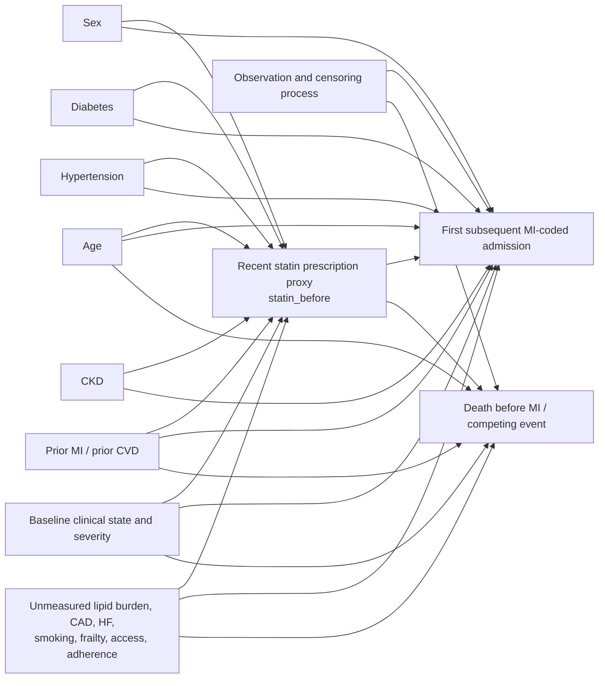

# Phase 8 - Candidate Statin DAG

## Provisional status

> **PROVISIONAL CANDIDATE DAG - NOT YET CLINICALLY VALIDATED.**

This is a domain-informed design graph for a future first-baseline, cross-admission question. It is not a discovered graph, final DAG, or evidence that the effect is identifiable.

## Graph

`M` is a competing event, not a baseline covariate. `C` denotes loss/end of observable follow-up and is shown to make the censoring problem explicit; its independence is not assumed.

## Important edge rationale

| Edge | Rationale and temporal requirement | Evidence status/confidence |
|---|---|---|
| Age -> statin proxy | Age can influence prescribing and the probability of a recent prescription. Age must be measured before the exposure window or treated as fixed. | Clinically plausible; master field verified; low-to-moderate confidence |
| Age -> subsequent MI | Age is a cardiovascular risk factor and mortality predictor. | Clinically established direction; moderate confidence |
| Sex -> statin proxy and MI | Sex/gender can influence treatment decisions, baseline risk, and care patterns. | Clinically plausible/established at broad level; moderate confidence |
| Diabetes, hypertension, CKD -> statin proxy | These histories can influence guideline-based prescribing and treatment indication. | Clinically plausible; project fields available but exact historical cutoff unresolved; low confidence for measured field |
| Diabetes, hypertension, CKD -> MI | These conditions increase cardiovascular risk. | Clinically established direction; moderate confidence |
| Prior MI/CVD -> statin proxy | Prior disease strongly affects indication and continuation of statin therapy. | Clinically plausible and highly important; measured history completeness unresolved |
| Prior MI/CVD -> subsequent MI | Prior disease increases recurrent MI risk. | Clinically established direction; moderate confidence |
| Baseline clinical state/severity -> statin proxy and MI | Presenting symptoms, severity, and clinician assessment may affect prescribing and future risk. The state must precede the exposure assessment to be a baseline confounder. | Plausible but not operationalized; low confidence |
| Unmeasured burden/access/adherence -> statin proxy and MI | Dyslipidemia, atherosclerotic burden, smoking, healthcare access, adherence, and clinician preference can jointly affect exposure and outcome. | Important unmeasured-confounding hypothesis; unresolved |
| `statin_before` proxy -> subsequent MI | This is the target causal arrow only under a well-defined intervention and valid temporal design. The current field is a proxy, so the arrow must not be interpreted as established treatment effect. | Target hypothesis; not identified |
| Exposure -> death | A true statin strategy could affect mortality; alternatively the proxy may be associated with mortality through indication and care. | Plausible; estimand-dependent |
| Baseline causes -> death | Risk factors, severity, and prior disease affect death, which competes with observed MI. | Clinically plausible; moderate confidence |
| Censoring process -> observed MI/death | Observation and hospital contact determine whether later events can be observed. | Design/measurement process; unresolved and potentially informative |

## ECG decision

The ECG feature block and `z_ecg` block are deliberately absent from the primary DAG. `ecg_time` identifies an observation time, but current audits do not establish that the chosen ECG is before statin assignment, nor that the representation is free of outcome- or future-data leakage. Adding `z_ecg` because it predicts MI would be a predictive-to-causal error. ECG variables may be added only in a separate, explicitly validated graph after a treatment-specific pre-exposure index rule and representation provenance are established.

## Competing structures

| Structure | When it could apply | Consequence |
|---|---|---|
| Baseline disease burden -> prescription proxy and MI | Most plausible for a chronic prevention question | Requires measuring burden sufficiently well; current residual confounding is substantial |
| Acute incipient event -> prescription and later MI | Applies if the prescription is triggered by evolving symptoms or admission planning | Creates reverse-causation risk; baseline window may not precede the disease process |
| Prescription -> acute severity -> MI | Applies only to a true treatment initiated before the later event, with severity as a mediator | Do not adjust for post-treatment severity when targeting a total effect |
| Healthcare access -> recorded prescription and observed MI | Applies when contact/documentation affects both exposure capture and outcome ascertainment | Requires explicit observation/censoring model; not solved by standard covariate adjustment |
| ECG state -> prescription and MI | Possible only if ECG predates assignment and reflects pre-treatment state | Currently quarantined because treatment-relative timing is unresolved |

## Temporal prohibitions

- A future MI admission must not determine baseline eligibility or `statin_before`.
- `is_MI`, `Label_Troponin`, `index_mi_time`, and `time_diff_hours` must not define exposure time.
- An in-hospital `statin_during` event must not be treated as baseline treatment without exact ordering and a separate estimand.
- `statin_after` cannot be a cause of the baseline admission or a baseline adjustment variable.
- A current-admission ECG cannot be assumed to precede a treatment merely because it is the first ECG.
- An ECG before `index_mi_time` is not necessarily before treatment and does not establish biological MI onset.
- Future admission diagnoses, treatments, ECGs, and labels cannot be carried backward into baseline covariates.
- Death and observation end must not be treated as ordinary independent censoring without an assumption or competing-risk estimand.

## Literature support

The graph and time-zero cautions follow standard causal-design principles: Pearl, *Causality*, 2nd ed., 2009; Hernan and Robins, *Causal Inference: What If*, 2020; and Hernan and Robins, "Using Big Data to Emulate a Target Trial When a Randomized Trial Is Not Available," *American Journal of Epidemiology*, 2016, 183:758-764, DOI: 10.1093/aje/kwv254. Immortal-time concerns are described by Suissa, "Immortal time bias in pharmaco-epidemiology," *American Journal of Epidemiology*, 2008, 167:492-499, DOI: 10.1093/aje/kwm324. Clinical support for statin reduction of major vascular events is summarized by the Cholesterol Treatment Trialists' Collaboration, *Lancet*, 2010, 376:1670-1681, DOI: 10.1016/S0140-6736(10)61350-5.

These references support design concepts and general clinical plausibility. They do not validate the project fields, the current exposure construction, or any arrow as identified in this dataset.
