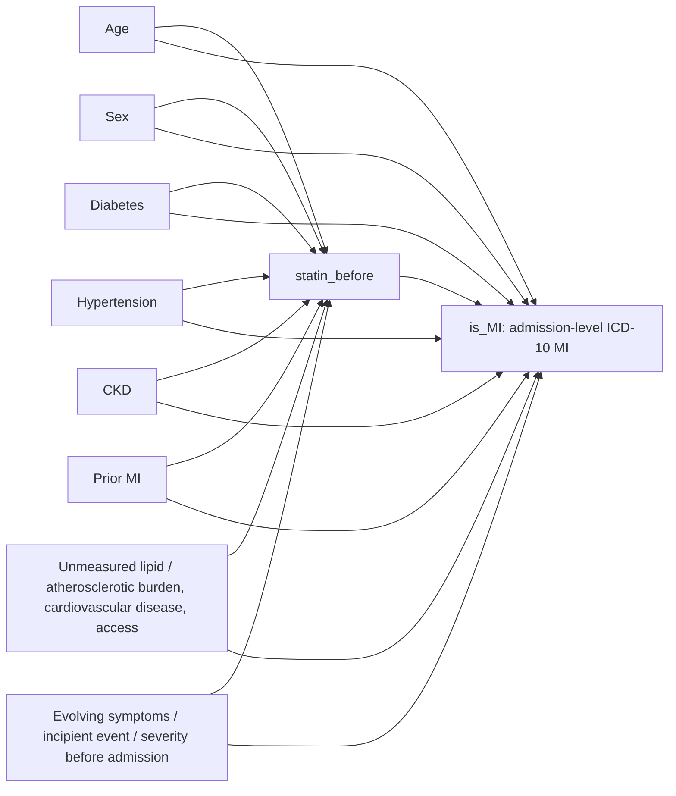

# Prescription-window causal design

**Status: design proposal only — not approved for effect estimation.**

This report begins the causal-design stage using the four admission-level
prescription-window flags in the current master dataset. It supersedes earlier
Phase 0 statements that no treatment-specific DAG could yet be drafted, but it
does not rewrite the historical Phase 1–7 audit artifacts. No effect
estimation, propensity-score estimation, matching, IPW, DML, or TMLE was run.

## 1. Final prescription-window estimand

For treatment \(T\), the candidate target is the average admission-level risk
difference:

`E[Y^1 - Y^0 | eligible admissions]`

where `Y` is the current admission-level `is_MI` outcome, `T=1` means the
admission has a qualifying prescription for the drug family in the documented
pre-admission prescription window, and `T=0` means it does not. The causal
question is:

> What is the causal effect of having a qualifying prescription for [TREATMENT]
> during the defined pre-admission prescription window on the subsequent
> MI-related outcome among eligible admissions?

This is a candidate estimand, not an identified estimand. It is explicitly not
an effect of initiating treatment, taking medication, receiving medication,
or inpatient administration. “Setting the binary flag” is not yet a
well-defined intervention: the flag pools potentially different prescription
dates, drugs, and treatment histories. The prescription-window boundaries also
conflict across the available documentation (see Section 2).

## 2. Treatment-specific exposure definitions

The current master schema and treatment audits support admission-level binary
indicators for qualifying prescription records before the admission boundary.
The `*_before` flags do not confirm outpatient medication use or treatment
initiation. Exact prescription-window boundaries must not be inferred from the
column names.

There is a material source-documentation discrepancy:

- The cohort extraction guide gives a 365-day lookback ending at the admission
  anchor in its worked statin prescription query.
- The later statin provenance notes describe an approximately 7-day window
  bounded by the prior discharge and admission anchor.
- The local workspace does not contain the upstream master construction script
  needed to determine which rule actually generated each master flag.

Accordingly, the exact window is unresolved. The exposure definition below is
limited to the strongest shared description supported by the master schema:
“a qualifying prescription in the pre-admission prescription window.” Do not
estimate until the exact window rule and consistency across all four flags are
confirmed from construction provenance.

Admission-level marginal prevalence is from the Phase 2 audit, which
deduplicated repeated ECG rows by `hadm_id` (191,369 admissions total):

| Candidate treatment | Master flag | Exposed admissions | Unexposed admissions | Prevalence |
|---|---|---:|---:|---:|
| Statin | `statin_before` | 13,203 | 178,166 | 6.90% |
| Aspirin | `aspirin_before` | 14,927 | 176,442 | 7.80% |
| Beta-blocker | `beta_blocker_before` | 6,099 | 185,270 | 3.19% |
| ACE inhibitor | `acei_before` | 6,196 | 185,173 | 3.24% |

These are descriptive admission counts, not effective sample sizes in a
finalized eligible cohort and not evidence of conditional positivity.

### Candidate-specific considerations

| Treatment | Exposure meaning and design considerations |
|---|---|
| `statin_before` | Qualifying pre-admission statin prescription (documented examples include atorvastatin, simvastatin, rosuvastatin, pravastatin, lovastatin, fluvastatin, and pitavastatin). The largest candidate after aspirin by exposure count; plausible chronic cardiovascular prevention exposure. Confounding by dyslipidemia, atherosclerotic burden, prior cardiovascular disease, and healthcare access is likely. A recent coronary event or symptoms could also prompt a prescription, creating reverse causality. |
| `aspirin_before` | Qualifying pre-admission aspirin prescription, including aspirin-containing combinations where captured by the source rule. Highest marginal prevalence, but aspirin may be prescribed in response to suspected or established coronary disease or symptoms close to the current admission. The event-proximal indication creates substantial reverse-causality and confounding-by-indication concerns. |
| `beta_blocker_before` | Qualifying pre-admission beta-blocker prescription (documented examples include metoprolol, atenolol, propranolol, carvedilol, and bisoprolol). Similar but slightly lower prevalence than ACE inhibitor. Indications such as heart failure, arrhythmia, ischemic disease, and hypertension may strongly predict both prescription and MI; several are not represented in the candidate covariates. Conditional positivity may be poor. |
| `acei_before` | Qualifying pre-admission ACE-inhibitor prescription (documented examples include lisinopril, enalapril, captopril, and ramipril). Similar but slightly higher prevalence than beta-blocker. Hypertension, CKD, diabetes, heart failure, and cardiovascular risk affect prescribing and MI; the available comorbidity flags may only partially capture these indications. Conditional positivity may be poor. |

For all four candidates, the design origin is the admission/window boundary
described in Section 4; none has an exact treatment time represented in the
master. The exact window rule is not confirmed for any candidate. Candidate
baseline covariates have not all been verified as measured before that window.
The current `is_MI` endpoint does not establish that the outcome occurred after
any of the four exposures. Thus each treatment has unresolved temporal
compatibility and reverse-causality risk; differences between candidates are
relative design considerations, not proof that any one is temporally valid.

## 3. Outcome definition and temporal compatibility

The candidate endpoint is `is_MI`, retained exactly as constructed: the binary
ICD-10 admission-level MI flag. It is the most defensible existing binary
MI-related endpoint for an admission-level question. The master dataset reports
7,362 MI admissions among 191,369 admissions in the provisional
first-ECG-per-admission audit.

This endpoint is **not currently causally compatible with a subsequent-event
claim**. `is_MI` identifies MI during the admission; it does not prove that the
MI event occurred after the pre-admission prescription window. The prescription
window may overlap an evolving or already-present event, and prescription
records may be prompted by that event. There is no validated at-risk cohort
definition or follow-up horizon that resolves this ordering. Therefore:

- Do not reinterpret `is_MI` as incident MI after the exposure window.
- Do not silently restrict or relabel outcomes to manufacture temporal order.
- Treat `is_MI` as the candidate outcome, with the temporal incompatibility as a
  blocker to causal interpretation and estimation.
- `Label_Troponin` remains a cohort label, not an independent causal outcome.
  The current master contains no `MI_Post-Incident` rows.
- Keep the documented time semantics unchanged: `index_mi_time` is based on
  the first qualifying Acute_MI troponin event; `final_index_time` is
  `index_mi_time` when available and otherwise `anchor_time`; `time_diff_hours`
  is ECG time relative to `final_index_time`. These event/ECG fields do not
  provide prescription assignment time and are not adjustment covariates.

## 4. Causal time origin and baseline timing

No exact medication timestamp or treatment-assignment moment is represented by
the master flag. The design is therefore admission/window-level:

- **Design origin:** the current admission boundary/anchor used to close the
  pre-admission prescription window.
- **Treatment status:** a summary indicator over that window, not an exposure
  assigned at the boundary.
- **Interpretation:** the design origin indexes the admission and its
  prescription-window status; it is not a medication time zero and does not
  establish that treatment preceded an ECG or MI.

Baseline chronology relative to the entire prescription window is not
established for all candidate covariates. Demographic attributes are
conceptually pre-existing, but `anchor_age` is recorded at admission. The
comorbidity documentation says prior-admission history, but exact coding
lookback and timing relative to the disputed exposure window are not verified.
Treat all six clinical/demographic variables as candidate baseline covariates,
not verified pre-window measurements, until their source construction is
confirmed.

The 95 engineered ECG features and 64 `z_ecg` dimensions are quarantined.
Their ECG timestamps can be compared to MI event metadata for some rows, but
the selected ECG is not established as pre-exposure and the `z_ecg` waveform,
training, and preprocessing provenance is incomplete. Neither block belongs
in the adjustment set merely because it predicts MI.

## 5. Treatment ranking

Ranking reflects current design quality, not expected effect size. Every
candidate inherits the same unresolved window and outcome-ordering blockers.

| Rank | Treatment | Rationale and principal blockers |
|---:|---|---|
| 1 | `statin_before` | Best candidate to take forward first: 13,203 exposed admissions (6.90%), a clinically interpretable chronic-prevention prescription class, and less obviously acute/event-proximal than aspirin. It is not “ready”: unmeasured lipid/atherosclerotic indication, possible event-triggered prescribing, disputed window, and incompatible outcome timing remain. |
| 2 | `aspirin_before` | Highest prevalence (14,927; 7.80%), which helps marginal counts, but stronger concern that prescription is associated with suspected/established coronary disease or the presenting event. This makes reverse causality and indication bias especially serious. |
| 3 | `acei_before` | 6,196 exposed admissions (3.24%). Some major indications overlap measured candidate comorbidities, but heart failure and broader cardiovascular status are not adequately represented; limited prevalence raises conditional-overlap concerns. |
| 4 | `beta_blocker_before` | 6,099 exposed admissions (3.19%). Low prevalence plus likely unmeasured arrhythmia, heart failure, and ischemic-disease indications; conditional positivity is a substantial concern. Difference from ACE inhibitor is small and the ordering is provisional. |

Statin is the strongest candidate **for design development only**, not for
estimation. It is the only candidate advanced to a treatment-specific DAG in
this report; the other candidates inherit the same outcome/time-order blockers
and have no better supported design. Aspirin's greater prevalence does not
outweigh its stronger event-proximal prescription concern on the evidence
currently available. Drug examples are not a complete source-matching rule;
the exact matching logic remains subject to the missing construction
provenance.

## 6. Variable causal-role classification

Roles below are hypotheses for a statin-window design; they are not automatic
edges. Domain constraints from Phase 6 constrain plausible models but do not
force causal relationships.

| Variable(s) | Candidate role in this design | Eligibility / handling |
|---|---|---|
| `statin_before` | Exposure | Prescription-window indicator only; no initiation or use claim. |
| `is_MI` | Candidate admission-level outcome | Not established as occurring after exposure window; temporal incompatibility blocks identification. |
| `anchor_age` | Plausible confounder and prognostic factor; age may modify effect | Candidate adjustment variable if source timing supports it. Not a validated pre-window measurement yet. |
| `sex_male` | Plausible confounder and prognostic factor; effect modification is possible | Fixed attribute and likely pre-existing, but confirm source semantics. |
| `diabetes`, `hypertension`, `ckd`, `prior_mi` | Plausible confounders and prognostic factors; some may modify effects | Prior-admission histories could affect both prescribing and MI. Include only if documented before the exposure window; available provenance does not yet establish exact timing or completeness. |
| Unmeasured dyslipidemia, atherosclerotic burden, heart failure, smoking, frailty, healthcare access, and evolving symptoms | Plausible common causes / indication factors | Important residual confounders; not adequately measured in the listed candidate set. |
| 95 ECG-derived features and 64 `z_ecg` dimensions | Predictive representations with unresolved causal role | **Quarantined**: cannot classify as baseline, confounder, mediator, or collider without temporal and provenance evidence. Exclude from adjustment. |
| Other `*_before` therapies | Potential co-exposures or proxies for indication | Do not adjust automatically. Their timing, common causes, and relationship to the target prescription need a separate causal argument. |
| `*_during`, `statin_after`, `vasopressor_during`, `mech_vent_during` | Potential post-origin variables, mediators, or severity markers | Exclude from baseline adjustment; likely downstream of admission/acute severity and not established pre-exposure. |
| `Label_Troponin` | Cohort label | Not a second independent causal outcome and not an adjustment variable. |
| `index_mi_time`, `final_index_time`, `time_diff_hours` | Event/ECG timing metadata | Not baseline covariates. Do not condition on them to define the exposure or adjust for them. |
| `study_id`, `SubjectID`, `hadm_id` | Identifiers / dependence and linkage fields | Never ordinary adjustment variables. Use `hadm_id` to define the admission unit and `SubjectID` to account for repeated-patient dependence or cohort construction. |

## 7. Statin-specific DAG and backdoor paths

This is the first treatment-specific DAG because statin is ranked first. It is
a design hypothesis, not a data-discovered graph. `statin_before -> is_MI` is
the target causal arrow **only if** the outcome is subsequently ascertained;
that temporal condition is not currently met.

The DAG does not force a `statin_before -> z_ecg` or `z_ecg -> is_MI` path.
ECG-derived variables are intentionally omitted pending temporal eligibility.
The Phase 6 constraints are plausible-edge hypotheses only; they do not
establish these arrows.

Plausible backdoor paths include:

- `statin_before <- age -> is_MI`
- `statin_before <- sex -> is_MI`
- `statin_before <- diabetes -> is_MI`
- `statin_before <- hypertension -> is_MI`
- `statin_before <- CKD -> is_MI`
- `statin_before <- prior MI -> is_MI`
- `statin_before <- unmeasured lipid/atherosclerotic burden -> is_MI`
- `statin_before <- evolving symptoms/incipient event -> is_MI`

The measured paths may be blocked by the candidate clinical variables only if
they are valid pre-window measurements and adequately capture the common
causes. The unmeasured indication and event-proximity paths remain open.
Selection into an admission/ECG-observed cohort may also create selection bias
if both treatment history and illness severity affect admission or ECG capture;
the selection process has not been modeled or validated.

## 8. Provisional adjustment set and exclusions

### Candidate measured set

`{anchor_age, sex_male, diabetes, hypertension, ckd, prior_mi}`

Rationale:

- Age and sex are plausible upstream determinants of prescribing and MI risk.
- Diabetes, hypertension, and CKD are plausible indications or risk factors
  relevant to statin prescription and MI.
- Prior MI is a strong plausible cause of both secondary-prevention statin
  prescribing and recurrent MI.

This is a **provisional candidate set**, not a proven minimal sufficient set.
Each variable must be verified to precede the exact prescription window and
measured sufficiently well. No adjustment set composed of these variables can
block the plausible unmeasured confounding paths listed above. Therefore no
valid identifying adjustment set is established from the current dataset.

### Explicit exclusions

- **ECG features and `z_ecg`:** quarantined for unresolved relation to the
  prescription window and incomplete provenance. They may be downstream
  measurements, mediators, severity proxies, or colliders; their role is not
  established. Predictive performance is not causal justification.
- **`Label_Troponin`, `index_mi_time`, `final_index_time`, `time_diff_hours`:**
  outcome/cohort or event-time metadata, not baseline covariates. Conditioning
  on event timing can induce selection and cannot repair exposure ordering.
- **Other treatment flags and inpatient interventions:** no automatic
  adjustment; could be co-treatments, mediators, severity responses, or
  colliders, and their timing is not suitable for baseline adjustment.
- **Post-discharge `statin_after`:** downstream of the admission period.
- **Identifiers:** not causal covariates; reserve them for linkage, admission
  unit definition, repeated-measures handling, or clustering.

No variable is classified as a confirmed mediator or collider because the
necessary temporal/causal evidence is unavailable. The acute-care variables,
ECG representations, and cohort selection are specifically flagged as
potential descendants/colliders so they are not adjusted for by default.

## 9. Identification assumptions

| Assumption | Status and testability |
|---|---|
| Consistency | Not established. A binary “any qualifying prescription” bundles different drug records, dates, durations, and treatment histories; an intervention corresponding to the flag must be specified. Not empirically testable from the flag alone. |
| Exchangeability / no unmeasured confounding | Implausible on current measured variables alone. Lipid status, atherosclerotic burden, heart failure, smoking, frailty, healthcare access, and evolving event symptoms may influence both prescription and MI. Cannot be proven from observed data; sensitivity analysis could assess robustness only after the design is valid. |
| Positivity | Marginal exposed counts are nonzero for all four treatments. Conditional positivity is unknown, especially for beta-blocker and ACE-inhibitor flags with about 3.2% prevalence. Requires diagnostics in the finalized eligible population; observed counts alone do not establish it. |
| Correct temporal ordering | Not established and currently contradicted as a guaranteed property: no exact prescription timestamp in master; outcome time may be during or before the window; no treatment-before-ECG guarantee. This is a hard blocker, not an assumption to gloss over. |
| Treatment-definition validity | Partial only. Prescription presence is the observable exposure; actual outpatient use, duration, dose, and initiation are not confirmed. Exact window boundaries conflict in local documentation. |
| Outcome-definition validity | `is_MI` is the current ICD-10 admission-level MI flag and is preferable to treating `Label_Troponin` as an independent endpoint. But a subsequent MI event and follow-up horizon are not established; this fails the requested subsequent-outcome interpretation. |
| Interference / SUTVA | No interference between different patients is a reasonable working assumption but unverified. Repeated admissions within a patient create dependence and possible treatment-history carryover; admissions cannot be treated as independent. A later analysis must define recurrent-admission handling and account for patient clustering or select one index admission without using identifiers as covariates. |

## 10. Positivity, limitations, and readiness

**Positivity:** Statin and aspirin have approximately 6.9% and 7.8% marginal
prevalence, respectively. Beta-blocker and ACE-inhibitor exposures are
approximately 3.2%. The counts may support describing the cohort, but treatment
overlap after restricting to temporally eligible admissions and conditioning
on confounders is unknown. No overlap modeling was performed.

**Remaining limitations:**

1. Exact prescription-window boundaries and upstream feature-construction
   provenance are unresolved.
2. The binary prescription flag does not confirm active outpatient use,
   medication adherence, dose, duration, or new-user status.
3. The current `is_MI` endpoint does not guarantee MI occurs after the
   prescription window; no valid subsequent-event horizon or risk-set
   eligibility rule is established.
4. The measured clinical variables may not be verified as pre-window and omit
   important indications and cardiovascular risk factors.
5. ECG and latent features remain quarantined due to unresolved timing and
   provenance.
6. The master data contain repeated ECGs and repeated admissions per patient;
   admission-level counts do not imply independent observations.
7. Selection into the master admission/ECG cohort may limit target-population
   interpretation and induce selection bias.

**Ready for causal estimation? No.** Do not run ATE/CATE, propensity scores for
final estimation, IPW, matching, DML, or TMLE until the exposure-window rule,
subsequent outcome/risk set, temporal order, and covariate timing are reviewed
and approved.

## FINAL RECOMMENDED DESIGN

- **Exposure:** `statin_before` — presence of a qualifying statin prescription
  in the defined pre-admission prescription window; not confirmed use or
  initiation. The exact window must first be reconciled from source provenance.
- **Outcome:** `is_MI` — current ICD-10 admission-level MI flag, the best
  existing binary MI endpoint, but not yet justified as subsequent to exposure.
- **Adjustment set:** provisional candidate
  `{anchor_age, sex_male, diabetes, hypertension, ckd, prior_mi}` only if
  timing and construction are confirmed; this is not a proven sufficient set.
  ECG features, `z_ecg`, event-time metadata, acute/post-admission variables,
  and identifiers are excluded from adjustment.
- **Estimand:** candidate average risk difference in admission-level `is_MI`
  under a policy yielding at least one qualifying statin prescription in the
  pre-admission window versus no qualifying statin prescription, among eligible
  admissions. This is not a treatment-initiation or medication-taking effect,
  and consistency is not established until the prescription intervention is
  made well-defined.
- **Population:** provisional current master-dataset admissions; the eligible
  at-risk population is unresolved because `is_MI` may precede or overlap the
  exposure window. Do not claim the current population identifies an effect on
  subsequent MI.
- **Identification assumptions:** consistency for a specified prescription
  policy; conditional exchangeability given sufficient pre-window covariates;
  conditional positivity; exposure-before-outcome ordering; valid exposure and
  outcome measurement; and no relevant interference, with repeated-patient
  dependence handled. These assumptions are not currently met or established.

**Decision:** statin is the strongest candidate for further design work, but
this design is **NOT READY** for causal estimation and requires review and
approval before proceeding.

## Evidence reviewed

- [Phase F master-dataset schema](../Phase%20F%20%E2%80%94%20Master%20Dataset.md)
- [Longitudinal cohort extraction guide](../longitudinal_mi_cohort_extraction.md)
- [Phase 2 treatment/outcome audit results](../../causal_audit/phase2/phase2_audit_results.json)
- [Phase 4 discovery-ready dataset report](../../causal_audit/phase4/phase4_discovery_ready_dataset_report.md)
- [Phase 5 `z_ecg` causal-role audit](../../causal_audit/phase5/phase5_z_ecg_causal_role_audit_report.md)
- [Phase 6 background causal constraints](../../causal_audit/phase6/phase6_background_causal_constraints_report.md)
- [Cross-treatment prescription provenance notes](./treatment_timing/EXPOSURE_PROVENANCE_ALL_TREATMENTS.md)
- [Statin prescription provenance notes](./statin/EXPOSURE_PROVENANCE.md)

The Phase 2 prevalence figures count admissions after grouping repeated ECG
rows by `hadm_id`. These descriptive counts do not establish treatment timing,
causal effects, or conditional support.
