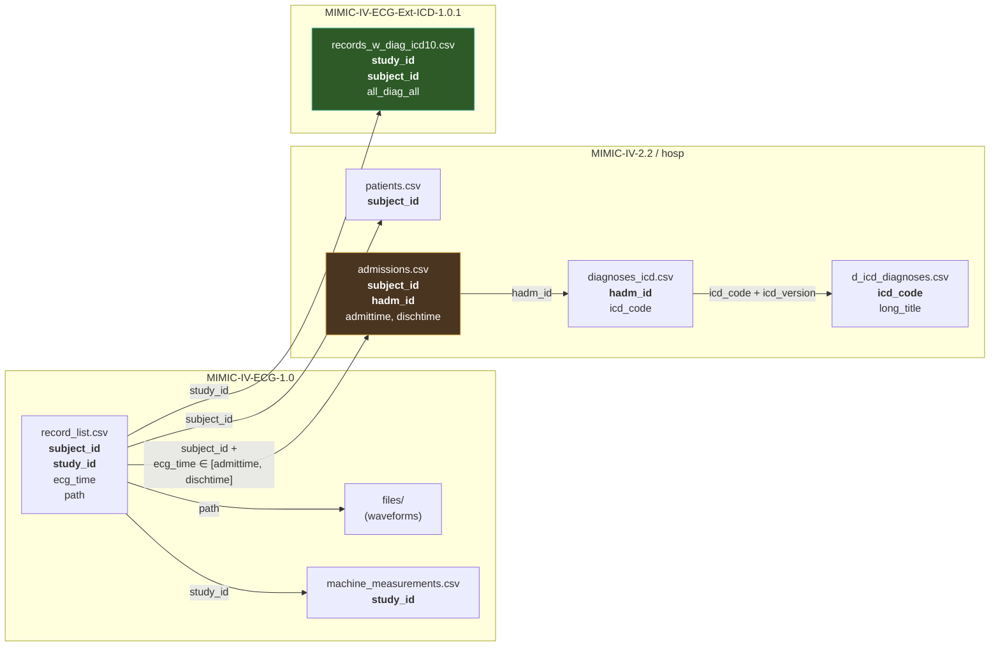

# Linking MIMIC-IV-ECG Waveforms to Disease Diagnoses

> **The Core Problem**: MIMIC-IV-ECG waveform files (`.dat`/`.hea` in `files/`) contain raw 12-lead signals — voltage over time — with **zero diagnostic labels**. The labels live in an entirely separate database (MIMIC-IV-2.2 Clinical), and linking them requires either a multi-step relational join or a pre-computed extension dataset.

---

## 1. Exact Database Locations of Diagnostic Labels

Diagnostic ICD codes exist in **two places** across your `data/raw/` folder:

### 1A. Primary Source: MIMIC-IV-2.2 Clinical Database (`hosp/` module)

The canonical diagnosis data lives in three files that form a lookup chain:

```
MIMIC-IV-2.2/
└── hosp/
    ├── diagnoses_icd.csv    ← Per-admission ICD codes (the fact table)
    ├── d_icd_diagnoses.csv  ← ICD code → human-readable name (the dictionary)
    └── admissions.csv       ← Admission timestamps (the temporal anchor)
```

#### [diagnoses_icd.csv](file:///c:/Users/Acer/Desktop/Capstone/Capstone/data/raw/MIMIC-IV-2.2/hosp/diagnoses_icd.csv) — The Diagnosis Fact Table

| Column | Type | Description |
|--------|------|-------------|
| `subject_id` | int | Patient identifier (links to ECG `subject_id`) |
| `hadm_id` | int | Hospital admission identifier |
| `seq_num` | int | Priority rank (1 = primary diagnosis) |
| `icd_code` | str | ICD-9 or ICD-10 code (e.g., `I2101` for STEMI of LAD) |
| `icd_version` | int | `9` or `10` — you **must** check this |

> [!IMPORTANT]
> This table contains **all diagnoses for all admissions for all patients** in MIMIC-IV (~135 MB). A single admission typically has 5–20 ICD codes. This is a many-to-one relationship with admissions.

#### [d_icd_diagnoses.csv](file:///c:/Users/Acer/Desktop/Capstone/Capstone/data/raw/MIMIC-IV-2.2/hosp/d_icd_diagnoses.csv) — The Code Dictionary

| Column | Type | Description |
|--------|------|-------------|
| `icd_code` | str | The ICD code |
| `icd_version` | int | `9` or `10` |
| `long_title` | str | e.g., "ST elevation (STEMI) myocardial infarction involving left anterior descending coronary artery" |

#### [admissions.csv](file:///c:/Users/Acer/Desktop/Capstone/Capstone/data/raw/MIMIC-IV-2.2/hosp/admissions.csv) — The Temporal Anchor

| Column | Type | Description |
|--------|------|-------------|
| `subject_id` | int | Patient identifier |
| `hadm_id` | int | Hospital admission identifier |
| `admittime` | datetime | Admission timestamp |
| `dischtime` | datetime | Discharge timestamp |
| `edregtime` | datetime | ED registration time (if via emergency) |
| `edouttime` | datetime | ED departure time |
| `hospital_expire_flag` | int | 1 = died during admission |

> [!NOTE]
> The `admittime`–`dischtime` window is the **temporal bridge** that determines which admission an ECG belongs to. An ECG with `ecg_time` falling within `[admittime, dischtime]` for a given `hadm_id` inherits that admission's diagnoses.

---

### 1B. Pre-Computed Source: MIMIC-IV-ECG-Ext-ICD-1.0.1

This extension dataset has **already performed the linking** for you:

```
MIMIC-IV-ECG-Ext-ICD-1.0.1/
└── records_w_diag_icd10.csv    ← ECG-level rows with ICD-10 codes pre-attached
```

#### [records_w_diag_icd10.csv](file:///c:/Users/Acer/Desktop/Capstone/Capstone/data/raw/MIMIC-IV-ECG-Ext-ICD-1.0.1/records_w_diag_icd10.csv) (~339 MB)

This is the **single most important file for your project**. Full column inventory:

| Column | Type | Description |
|--------|------|-------------|
| `file_name` | str | Full path to waveform file (e.g., `mimic-iv-ecg-.../files/p1000/p10000032/s40689238/40689238`) |
| `study_id` | int | Unique ECG study identifier |
| `subject_id` | int | Patient identifier |
| `ecg_time` | datetime | When the ECG was recorded |
| `ed_stay_id` | float | ED stay identifier (NaN if not in ED) |
| `ed_hadm_id` | float | Hospital admission linked via ED stay (NaN if N/A) |
| `hosp_hadm_id` | float | Hospital admission linked via inpatient stay (NaN if N/A) |
| `ed_diag_ed` | str (list) | ICD-10 codes from the **ED diagnosis** at that ED visit |
| `ed_diag_hosp` | str (list) | ICD-10 codes from the **hospital admission** linked via the ED visit |
| `hosp_diag_hosp` | str (list) | ICD-10 codes from the **hospital admission** (direct inpatient) |
| `all_diag_hosp` | str (list) | Union of `ed_diag_hosp` + `hosp_diag_hosp` |
| `all_diag_all` | str (list) | Union of **all** ICD-10 codes from any source |
| `gender` | str | `M` or `F` |
| `age` | float | Age at ECG time |
| `anchor_year` | float | De-identification anchor year |
| `anchor_age` | float | Age at anchor year |
| `dod` | str | Date of death (if applicable) |
| `ecg_no_within_stay` | int | Ordinal position of this ECG within the stay |
| `ecg_taken_in_ed` | bool | Whether the ECG was taken in the ED |
| `ecg_taken_in_hosp` | bool | Whether the ECG was taken during hospitalization |
| `ecg_taken_in_ed_or_hosp` | bool | Whether taken in either setting |
| `fold` | int | Random fold assignment |
| `strat_fold` | int | **Stratified** fold assignment (use this for train/test splits) |

> [!TIP]
> The `all_diag_all` column is the most inclusive diagnosis set. For MI classification, filter for ICD-10 codes starting with `I21` (acute MI), `I22` (subsequent MI), or `I25` (chronic ischemic heart disease).

---

### 1C. Supplementary Label Sources (within MIMIC-IV-ECG-1.0)

These are **not** ICD diagnosis codes, but machine-generated ECG interpretations:

#### [machine_measurements.csv](file:///c:/Users/Acer/Desktop/Capstone/Capstone/data/raw/MIMIC-IV-ECG-1.0/machine_measurements.csv)

| Label-Adjacent Columns | Description |
|------------------------|-------------|
| `report_0` through `report_17` | Free-text ECG machine interpretations (e.g., "Sinus rhythm", "Possible anterior MI", "ST elevation") |

These text reports can serve as **weak labels** or supplementary features but should NOT be treated as ground-truth diagnoses.

---

## 2. Relational Schema & Interlinking

### 2.1 The Join Problem — Visualized



### 2.2 The Fundamental Gap

The ECG dataset (`record_list.csv`) has:
- ✅ `subject_id` — identifies the patient
- ✅ `study_id` — identifies the ECG
- ✅ `ecg_time` — when the ECG was taken
- ❌ **NO `hadm_id`** — does not directly tell you which admission this ECG belongs to

The diagnosis table (`diagnoses_icd.csv`) requires `hadm_id` to retrieve diagnoses. This creates a **missing key** problem that must be resolved via temporal join.

### 2.3 Manual Join Strategy (from-scratch path)

#### Step 1: Match ECG to Admission via Temporal Window

```python
import pandas as pd

# Load the data
record_list = pd.read_csv('MIMIC-IV-ECG-1.0/record_list.csv',
                           parse_dates=['ecg_time'])
admissions  = pd.read_csv('MIMIC-IV-2.2/hosp/admissions.csv',
                           parse_dates=['admittime', 'dischtime',
                                        'edregtime', 'edouttime'])

# INNER JOIN on subject_id — every ECG gets all admissions for that patient
merged = record_list.merge(admissions, on='subject_id', how='inner')

# TEMPORAL FILTER: keep only rows where ecg_time falls within the admission window
# Use edregtime when available (ED visit starts before formal admission)
merged['window_start'] = merged['edregtime'].fillna(merged['admittime'])
merged['window_end']   = merged['dischtime']

ecg_with_hadm = merged[
    (merged['ecg_time'] >= merged['window_start']) &
    (merged['ecg_time'] <= merged['window_end'])
][['subject_id', 'study_id', 'ecg_time', 'path', 'hadm_id']].copy()

print(f"ECGs matched to admissions: {len(ecg_with_hadm):,}")
print(f"ECGs without admission match (outpatient): "
      f"{len(record_list) - ecg_with_hadm['study_id'].nunique():,}")
```

#### Step 2: Join to ICD Diagnoses

```python
diagnoses     = pd.read_csv('MIMIC-IV-2.2/hosp/diagnoses_icd.csv')
icd_dict      = pd.read_csv('MIMIC-IV-2.2/hosp/d_icd_diagnoses.csv')

# Attach all ICD codes for each matched admission
ecg_with_dx = ecg_with_hadm.merge(diagnoses, on=['subject_id', 'hadm_id'], how='left')

# Decode the ICD codes to human-readable names
ecg_with_dx = ecg_with_dx.merge(
    icd_dict, on=['icd_code', 'icd_version'], how='left'
)

# Result: each row is one (ECG, diagnosis) pair
# An ECG with 10 diagnoses → 10 rows
print(ecg_with_dx[['study_id', 'ecg_time', 'icd_code', 'icd_version', 'long_title']].head(10))
```

#### Step 3: Filter for MI-Specific ICD Codes

```python
# ICD-10 MI codes
MI_ICD10_PREFIXES = ['I21', 'I22']  # Acute MI and subsequent MI
# ICD-9 MI codes (for older admissions)
MI_ICD9_PREFIXES = ['410']          # Acute myocardial infarction

def is_mi_code(row):
    code = str(row['icd_code'])
    if row['icd_version'] == 10:
        return any(code.startswith(p) for p in MI_ICD10_PREFIXES)
    elif row['icd_version'] == 9:
        return any(code.startswith(p) for p in MI_ICD9_PREFIXES)
    return False

ecg_with_dx['is_mi'] = ecg_with_dx.apply(is_mi_code, axis=1)

# Get per-ECG MI label (True if ANY diagnosis for that admission is MI)
mi_labels = ecg_with_dx.groupby('study_id')['is_mi'].any().reset_index()
mi_labels.columns = ['study_id', 'has_mi_diagnosis']

print(f"ECGs with MI diagnosis: {mi_labels['has_mi_diagnosis'].sum():,}")
print(f"ECGs without MI diagnosis: {(~mi_labels['has_mi_diagnosis']).sum():,}")
```

#### Step 4: Load the Waveform for a Labelled ECG

```python
import wfdb

# Pick one MI-positive ECG
mi_ecg = ecg_with_hadm[
    ecg_with_hadm['study_id'].isin(
        mi_labels[mi_labels['has_mi_diagnosis']]['study_id']
    )
].iloc[0]

# The path column gives the WFDB record path
waveform_path = f"MIMIC-IV-ECG-1.0/{mi_ecg['path']}"
signal, meta = wfdb.rdsamp(waveform_path)

print(f"Signal shape: {signal.shape}")        # (N_samples, 12) — 12 leads
print(f"Sampling frequency: {meta['fs']} Hz")
print(f"Lead names: {meta['sig_name']}")
print(f"Duration: {signal.shape[0] / meta['fs']:.1f} seconds")
```

### 2.4 SQL-Equivalent Logic

For those working with MIMIC-IV loaded into a database (BigQuery, PostgreSQL):

```sql
-- Step 1: Link ECGs to admissions via temporal overlap
WITH ecg_admission AS (
    SELECT
        r.subject_id,
        r.study_id,
        r.ecg_time,
        r.path,
        a.hadm_id,
        a.admittime,
        a.dischtime
    FROM `mimic_iv_ecg.record_list` r
    INNER JOIN `mimic_iv.admissions` a
        ON  r.subject_id = a.subject_id
        AND r.ecg_time >= COALESCE(a.edregtime, a.admittime)
        AND r.ecg_time <= a.dischtime
),

-- Step 2: Attach ICD codes
ecg_with_icd AS (
    SELECT
        ea.study_id,
        ea.ecg_time,
        ea.path,
        ea.hadm_id,
        d.icd_code,
        d.icd_version,
        d.seq_num,
        dd.long_title
    FROM ecg_admission ea
    LEFT JOIN `mimic_iv.diagnoses_icd` d
        ON ea.hadm_id = d.hadm_id
    LEFT JOIN `mimic_iv.d_icd_diagnoses` dd
        ON d.icd_code = dd.icd_code
        AND d.icd_version = dd.icd_version
),

-- Step 3: Flag MI
ecg_mi_flag AS (
    SELECT
        study_id,
        ecg_time,
        path,
        MAX(CASE
            WHEN icd_version = 10 AND icd_code LIKE 'I21%' THEN 1
            WHEN icd_version = 10 AND icd_code LIKE 'I22%' THEN 1
            WHEN icd_version = 9  AND icd_code LIKE '410%' THEN 1
            ELSE 0
        END) AS has_mi
    FROM ecg_with_icd
    GROUP BY study_id, ecg_time, path
)

SELECT * FROM ecg_mi_flag;
```

---

## 3. Pre-Computed Shortcut: MIMIC-IV-ECG-Ext-ICD-1.0.1

### 3.1 What It Is

The [MIMIC-IV-ECG-Ext-ICD v1.0.1](file:///c:/Users/Acer/Desktop/Capstone/Capstone/data/raw/MIMIC-IV-ECG-Ext-ICD-1.0.1) dataset is an **officially-hosted PhysioNet extension** that has **already performed the temporal join** between MIMIC-IV-ECG recordings and MIMIC-IV-2.2 clinical diagnoses.

### 3.2 What It Contains

A single file — [records_w_diag_icd10.csv](file:///c:/Users/Acer/Desktop/Capstone/Capstone/data/raw/MIMIC-IV-ECG-Ext-ICD-1.0.1/records_w_diag_icd10.csv) (~339 MB) — with one row per ECG recording. Each row contains:

1. **ECG identification**: `file_name`, `study_id`, `subject_id`, `ecg_time`
2. **Admission linkage**: `ed_stay_id`, `ed_hadm_id`, `hosp_hadm_id`
3. **Five diagnosis columns** at different linkage levels:
   - `ed_diag_ed` — ICD-10 codes from the ED visit itself
   - `ed_diag_hosp` — ICD-10 codes from the hospital admission linked via ED
   - `hosp_diag_hosp` — ICD-10 codes from a direct hospital admission
   - `all_diag_hosp` — Union of hospital-linked diagnoses
   - `all_diag_all` — **Union of ALL available diagnoses** (most inclusive)
4. **Demographics**: `gender`, `age`, `anchor_year`, `anchor_age`, `dod`
5. **Context flags**: `ecg_taken_in_ed`, `ecg_taken_in_hosp`, `ecg_taken_in_ed_or_hosp`, `ecg_no_within_stay`
6. **Ready-made splits**: `fold`, `strat_fold` (stratified — use this one)

### 3.3 How to Use It — The Fast Path

```python
import pandas as pd
import ast
import wfdb

# ── Load the pre-computed linkage ──
df = pd.read_csv(
    'MIMIC-IV-ECG-Ext-ICD-1.0.1/records_w_diag_icd10.csv',
    dtype={'ed_stay_id': 'str', 'ed_hadm_id': 'str', 'hosp_hadm_id': 'str'}
)

# ── Parse the diagnosis lists (stored as string-encoded Python lists) ──
def safe_parse_list(x):
    """Safely parse string-encoded Python lists like "['I2101', 'E119']" """
    if pd.isna(x) or x == '[]':
        return []
    try:
        return ast.literal_eval(x)
    except (ValueError, SyntaxError):
        return []

df['all_diag_all_parsed'] = df['all_diag_all'].apply(safe_parse_list)

# ── Create binary MI label ──
MI_ICD10_PREFIXES = ('I21', 'I22')

def has_mi(diag_list):
    return any(str(code).startswith(MI_ICD10_PREFIXES) for code in diag_list)

df['mi_label'] = df['all_diag_all_parsed'].apply(has_mi).astype(int)

# ── Summary ──
print(f"Total ECGs:           {len(df):>10,}")
print(f"ECGs with MI:         {df['mi_label'].sum():>10,}")
print(f"ECGs without MI:      {(1-df['mi_label']).sum():>10,}")
print(f"MI prevalence:        {df['mi_label'].mean():>10.2%}")

# ── Use stratified folds for train/test ──
train = df[df['strat_fold'] != 10]
test  = df[df['strat_fold'] == 10]
print(f"\nTrain set: {len(train):,} ECGs ({train['mi_label'].mean():.2%} MI)")
print(f"Test set:  {len(test):,} ECGs ({test['mi_label'].mean():.2%} MI)")

# ── Load a waveform ──
sample = df[df['mi_label'] == 1].iloc[0]
# Extract the relative path from the file_name column
# file_name looks like: "mimic-iv-ecg-.../files/p1000/p10000032/s40689238/40689238"
wf_path = sample['file_name'].split('/files/')[-1]
wf_path = f"MIMIC-IV-ECG-1.0/files/{wf_path}"

signal, meta = wfdb.rdsamp(wf_path)
print(f"\nLoaded MI-positive ECG: {signal.shape}")
```

### 3.4 Why Use the Extension Instead of Manual Joins

| Dimension | Manual Join | Extension Dataset |
|-----------|------------|-------------------|
| **Complexity** | 3-table join with temporal logic | Single CSV read |
| **Edge cases handled** | Must handle yourself | Pre-resolved (ED vs. inpatient, multiple admissions) |
| **Diagnosis granularity** | Single merged list | 5 separate lists by source (ED, hospital, combined) |
| **Demographics** | Requires separate join to `patients.csv` | Pre-attached (`gender`, `age`, `dod`) |
| **Train/test splits** | Must create your own | Pre-computed `strat_fold` |
| **ICD version** | Mixed ICD-9 and ICD-10 | **ICD-10 only** (standardized) |

> [!IMPORTANT]
> The extension dataset has already converted ICD-9 codes to ICD-10 equivalents, eliminating a major version-mixing headache. If you do manual joins against `diagnoses_icd.csv`, you'll encounter both ICD-9 and ICD-10 codes and must handle cross-mapping yourself.

---

## 4. Edge Cases & Pitfalls

### 4.1 Out-of-Hospital ECGs (No Matching Admission)

**Problem**: Not every ECG was recorded during a hospital or ED stay. Outpatient or pre-hospital ECGs have no `hadm_id` and therefore no admission-level diagnoses.

**Detection**:
```python
# In the extension dataset, these have NaN for both hadm columns
outpatient_ecgs = df[
    df['ed_hadm_id'].isna() &
    df['hosp_hadm_id'].isna()
]
print(f"Outpatient ECGs: {len(outpatient_ecgs):,} "
      f"({len(outpatient_ecgs)/len(df):.1%})")
```

**Resolution strategies**:
1. **Exclude them** — safest for supervised MI classification
2. **Use as unlabeled data** for semi-supervised learning
3. **Assign nearest-admission diagnoses** (risky — diagnoses from a different admission may be irrelevant)

```python
# Strategy 1: Filter to only in-hospital/ED ECGs
labeled_df = df[df['ecg_taken_in_ed_or_hosp'] == True].copy()
print(f"ECGs with admission context: {len(labeled_df):,}")
```

### 4.2 Multiple Diagnoses per Admission (One-to-Many)

**Problem**: A single admission typically has 5–20 ICD codes. An ECG taken during that admission inherits **all** of them, not just the cardiac one.

**Example**: An ECG for patient 10000032 has diagnoses `['F319', 'J449', 'B182', 'E871', 'V462', 'I9581', 'R188', 'Z21', 'Z66', 'F17200', 'E875', 'R64', 'K7469']` — only `I9581` (heart failure) is cardiac; the rest include HIV, COPD, bipolar disorder, etc.

**Resolution**:
```python
# Filter to only cardiac/MI-relevant ICD-10 code families
CARDIAC_PREFIXES = (
    'I20',   # Angina pectoris
    'I21',   # Acute myocardial infarction (STEMI/NSTEMI)
    'I22',   # Subsequent myocardial infarction
    'I23',   # Complications following acute MI
    'I24',   # Other acute ischemic heart diseases
    'I25',   # Chronic ischemic heart disease
    'I42',   # Cardiomyopathy
    'I44',   # AV and left bundle-branch block
    'I45',   # Other conduction disorders
    'I46',   # Cardiac arrest
    'I47',   # Paroxysmal tachycardia
    'I48',   # Atrial fibrillation and flutter
    'I49',   # Other cardiac arrhythmias
    'I50',   # Heart failure
)

def extract_cardiac_codes(diag_list):
    return [c for c in diag_list if str(c).startswith(CARDIAC_PREFIXES)]

df['cardiac_dx'] = df['all_diag_all_parsed'].apply(extract_cardiac_codes)
df['has_cardiac_dx'] = df['cardiac_dx'].apply(len) > 0
```

### 4.3 Missing `hadm_id` in ECG Records

**Problem**: The ECG dataset's [record_list.csv](file:///c:/Users/Acer/Desktop/Capstone/Capstone/data/raw/MIMIC-IV-ECG-1.0/record_list.csv) has `subject_id` and `study_id` but **no `hadm_id`**. You cannot directly join to `diagnoses_icd.csv`.

**Resolution**: This is exactly why you need the temporal join (Section 2.3) or the pre-computed extension (Section 3). The extension dataset provides `ed_hadm_id` and `hosp_hadm_id` — the `hadm_id` values that the ECG module is missing.

```python
# The extension dataset resolves this for you:
ecg_with_hadm = df[['study_id', 'ed_hadm_id', 'hosp_hadm_id']].copy()

# Prefer hosp_hadm_id, fall back to ed_hadm_id
ecg_with_hadm['hadm_id'] = (
    ecg_with_hadm['hosp_hadm_id']
    .fillna(ecg_with_hadm['ed_hadm_id'])
)
```

### 4.4 One ECG Matching Multiple Admissions (Temporal Overlap)

**Problem**: In rare cases, admission windows can overlap (e.g., an ED visit that becomes a hospital admission), causing a single ECG to match two `hadm_id` values.

**Resolution**: The extension dataset handles this by providing **separate columns** for ED-linked and hospital-linked admissions:
- `ed_hadm_id` — admission linked via the ED stay
- `hosp_hadm_id` — admission linked via direct inpatient admission

If doing manual joins, deduplicate by preferring the admission with the closer `admittime`:

```python
# Manual deduplication: keep the admission whose admittime is closest to ecg_time
merged['time_diff'] = abs(
    (merged['ecg_time'] - merged['admittime']).dt.total_seconds()
)
deduped = merged.sort_values('time_diff').drop_duplicates(
    subset='study_id', keep='first'
)
```

### 4.5 ICD-9 vs. ICD-10 Dual Coding

**Problem**: MIMIC-IV-2.2's `diagnoses_icd.csv` contains both ICD-9 codes (`icd_version=9`) and ICD-10 codes (`icd_version=10`). The transition happened mid-dataset (~2015). ICD-9 code `410.x` and ICD-10 code `I21.x` both mean "acute MI" but have completely different code structures.

**Resolution**:
```python
# Option A: Handle both versions with explicit mapping
MI_CODES = {
    9:  ['410'],            # ICD-9: 410.x = Acute MI
    10: ['I21', 'I22'],     # ICD-10: I21.x, I22.x = Acute MI
}

def is_mi(icd_code, icd_version):
    prefixes = MI_CODES.get(icd_version, [])
    return any(str(icd_code).startswith(p) for p in prefixes)

# Option B: Use the extension dataset which has already standardized to ICD-10
# (This is why the file is called "records_w_diag_icd10")
```

> [!CAUTION]
> If using `diagnoses_icd.csv` directly, **always check `icd_version`**. The same numeric code can mean completely different things in ICD-9 vs ICD-10. For example, code `250` is "Diabetes mellitus" in ICD-9 but does not exist in ICD-10.

### 4.6 Diagnosis Timing Ambiguity

**Problem**: Diagnoses in `diagnoses_icd.csv` are assigned at **discharge** and represent the final assessment. But the ECG was taken at `ecg_time`, which could be at admission (before the diagnosis was made). This means:
- An ECG taken on Day 1 of a 10-day stay gets labelled with diagnoses from Day 10
- Some diagnoses may be "developed during stay" rather than "present at ECG time"

**Resolution**:
```python
# Use seq_num to distinguish primary (presenting) vs. secondary diagnoses
# seq_num = 1 is the primary diagnosis (most likely the presenting complaint)
primary_dx = diagnoses[diagnoses['seq_num'] == 1]

# For MI specifically, you can also check if the ECG shows acute changes
# by cross-referencing machine_measurements.csv report columns
machine = pd.read_csv('MIMIC-IV-ECG-1.0/machine_measurements.csv')
report_cols = [f'report_{i}' for i in range(18)]
machine['ecg_report'] = machine[report_cols].fillna('').agg(' '.join, axis=1)
machine['machine_suggests_mi'] = machine['ecg_report'].str.contains(
    'infarct|MI|STEMI|ST elevation|ST segment elevation',
    case=False, na=False
)
```

### 4.7 The `file_name` Path Mismatch

**Problem**: The `file_name` in the extension dataset includes the full PhysioNet dataset prefix:
```
mimic-iv-ecg-diagnostic-electrocardiogram-matched-subset-1.0/files/p1000/p10000032/s40689238/40689238
```
But your local path structure is:
```
MIMIC-IV-ECG-1.0/files/p1000/p10000032/s40689238/40689238
```

**Resolution**:
```python
# Strip the PhysioNet prefix to get the local path
def to_local_path(file_name, base_dir='MIMIC-IV-ECG-1.0'):
    # Extract everything after 'files/'
    relative = file_name.split('/files/')[-1]
    return f"{base_dir}/files/{relative}"

df['local_path'] = df['file_name'].apply(to_local_path)
```

### 4.8 Empty Diagnosis Lists

**Problem**: Some ECGs in the extension dataset have `all_diag_all = '[]'` — an empty list. This means the ECG could not be linked to any admission, OR the linked admission had no ICD codes recorded.

**Resolution**:
```python
# Count empty-diagnosis ECGs
empty_dx = df[df['all_diag_all_parsed'].apply(len) == 0]
print(f"ECGs with no diagnoses: {len(empty_dx):,} ({len(empty_dx)/len(df):.1%})")

# Decision: exclude from supervised training, or treat as "unlabeled"
labeled_only = df[df['all_diag_all_parsed'].apply(len) > 0]
```

---

## 5. Recommended Production Pipeline

```python
"""
Complete pipeline: MIMIC-IV-ECG waveform → MI label → ready for training
"""
import pandas as pd
import numpy as np
import ast
import wfdb
from pathlib import Path

# ═══════════════════════════════════════════════════
# 1. LOAD THE EXTENSION DATASET (shortcut path)
# ═══════════════════════════════════════════════════
RAW = Path('data/raw')
df = pd.read_csv(RAW / 'MIMIC-IV-ECG-Ext-ICD-1.0.1' / 'records_w_diag_icd10.csv')

# ═══════════════════════════════════════════════════
# 2. PARSE DIAGNOSIS LISTS
# ═══════════════════════════════════════════════════
def safe_parse(x):
    if pd.isna(x) or x == '[]':
        return []
    try:
        return ast.literal_eval(x)
    except:
        return []

for col in ['ed_diag_ed', 'ed_diag_hosp', 'hosp_diag_hosp',
            'all_diag_hosp', 'all_diag_all']:
    df[col] = df[col].apply(safe_parse)

# ═══════════════════════════════════════════════════
# 3. CREATE MI LABELS
# ═══════════════════════════════════════════════════
MI_PREFIXES = ('I21', 'I22')

df['mi_label'] = df['all_diag_all'].apply(
    lambda codes: int(any(str(c).startswith(MI_PREFIXES) for c in codes))
)

# ═══════════════════════════════════════════════════
# 4. FILTER TO LABELED, IN-HOSPITAL ECGs
# ═══════════════════════════════════════════════════
df_labeled = df[
    (df['ecg_taken_in_ed_or_hosp'] == True) &
    (df['all_diag_all'].apply(len) > 0)
].copy()

# ═══════════════════════════════════════════════════
# 5. RESOLVE LOCAL WAVEFORM PATHS
# ═══════════════════════════════════════════════════
df_labeled['waveform_path'] = df_labeled['file_name'].apply(
    lambda x: str(RAW / 'MIMIC-IV-ECG-1.0' / 'files' / x.split('/files/')[-1])
)

# ═══════════════════════════════════════════════════
# 6. STRATIFIED TRAIN / TEST SPLIT
# ═══════════════════════════════════════════════════
train = df_labeled[df_labeled['strat_fold'] != 10]
test  = df_labeled[df_labeled['strat_fold'] == 10]

print(f"Train: {len(train):,}  (MI: {train['mi_label'].mean():.2%})")
print(f"Test:  {len(test):,}  (MI: {test['mi_label'].mean():.2%})")

# ═══════════════════════════════════════════════════
# 7. LOAD A WAVEFORM BATCH (example)
# ═══════════════════════════════════════════════════
def load_ecg(path, target_length=5000):
    """Load a 12-lead ECG, pad/truncate to fixed length."""
    signal, meta = wfdb.rdsamp(path)
    # signal shape: (N, 12)
    if signal.shape[0] > target_length:
        signal = signal[:target_length]
    elif signal.shape[0] < target_length:
        pad = np.zeros((target_length - signal.shape[0], 12))
        signal = np.vstack([signal, pad])
    return signal.astype(np.float32)

# Load a small batch for verification
sample = train.head(5)
for _, row in sample.iterrows():
    sig = load_ecg(row['waveform_path'])
    print(f"study_id={row['study_id']}, MI={row['mi_label']}, shape={sig.shape}")
```

---

## Summary Decision Tree

```
Do you need ECG → Disease Labels?
│
├─ YES, and you want it fast
│   └─ USE: records_w_diag_icd10.csv (Section 3)
│       • One CSV, pre-joined, ICD-10 standardized
│       • Column: all_diag_all for most inclusive labels
│       • Filter: codes starting with I21/I22 for MI
│       • Split: strat_fold column for reproducible evaluation
│
├─ YES, but you need full control / custom temporal logic
│   └─ USE: Manual join (Section 2)
│       • record_list.csv ──[subject_id + ecg_time ∈ window]──► admissions.csv
│       • admissions.csv ──[hadm_id]──► diagnoses_icd.csv
│       • diagnoses_icd.csv ──[icd_code]──► d_icd_diagnoses.csv
│       • Handle ICD-9/10 dual coding yourself
│
└─ YES, and you also want machine-generated ECG interpretations
    └─ ADDITIONALLY USE: machine_measurements.csv
        • report_0–report_17 columns contain free-text ECG interpretations
        • Can serve as weak labels or supplementary features
        • NOT ground-truth diagnoses
```

> [!NOTE]
> For your Causal Model for ECG Analysis on MI project, the recommended path is **Section 3** (the extension dataset). It gives you labeled ECGs with demographics, pre-computed folds, and resolved edge cases in a single file load. The manual join path is useful if you need to attach additional clinical data (troponin levels from `labevents.csv`, medications from `prescriptions.csv`) that isn't in the extension dataset — in which case you can join the extension's `ed_hadm_id`/`hosp_hadm_id` back to the MIMIC-IV-2.2 clinical tables.
