# Raw Data Folder — Complete File Analysis

> **Scope**: `data/raw/` — five PhysioNet datasets powering a **Causal Model for ECG Analysis on Myocardial Infarction (MI)**
>
> Each file is described with a 5-part structure:
> 1. **What It Is** — identity and dataset origin
> 2. **Structure** — format, columns, shape
> 3. **Core Function** — why it exists
> 4. **Key Inputs / Outputs** — what flows in and out
> 5. **System Role** — its job in the overall pipeline

---

## Table of Contents

- [1. Root Level](#1-root-level)
- [2. MIMIC-IV-2.2](#2-mimic-iv-22)
  - [2a. hosp/ (Hospital Module)](#2a-hosp-hospital-module)
  - [2b. icu/ (ICU Module)](#2b-icu-icu-module)
- [3. MIMIC-IV-ECG-1.0](#3-mimic-iv-ecg-10)
- [4. MIMIC-IV-ECG-Ext-ICD-1.0.1](#4-mimic-iv-ecg-ext-icd-101)
- [5. PTB-XL-1.0.3](#5-ptb-xl-103)
- [6. PTB-XL+-1.0.1](#6-ptb-xl-101)
- [7. Relationship Map](#7-relationship-map)

---

## 1. Root Level

### [.gitkeep](file:///c:/Users/Acer/Desktop/Capstone/Capstone/data/raw/.gitkeep)

| # | Detail |
|---|--------|
| 1 | A placeholder file that preserves the `data/raw/` directory structure in Git |
| 2 | 3-line plain text comment |
| 3 | Ensures Git tracks the otherwise-empty directory; actual data files are transferred out-of-band |
| 4 | **Input**: None. **Output**: Git tracks the folder |
| 5 | Housekeeping — no analytical role |

---

## 2. MIMIC-IV-2.2

> MIMIC-IV v2.2: de-identified EHR data from Beth Israel Deaconess Medical Center.  
> Split into two modules: **hosp** (hospital-wide) and **icu** (intensive care).

### Metadata Files

#### [CHANGELOG.txt](file:///c:/Users/Acer/Desktop/Capstone/Capstone/data/raw/MIMIC-IV-2.2/CHANGELOG.txt) · [LICENSE.txt](file:///c:/Users/Acer/Desktop/Capstone/Capstone/data/raw/MIMIC-IV-2.2/LICENSE.txt) · [SHA256SUMS.txt](file:///c:/Users/Acer/Desktop/Capstone/Capstone/data/raw/MIMIC-IV-2.2/SHA256SUMS.txt)

| # | Detail |
|---|--------|
| 1 | Dataset-level housekeeping files |
| 2 | Plain text. CHANGELOG lists version diffs; LICENSE is the PhysioNet Credentialed Health Data Use Agreement; SHA256SUMS has checksums per file |
| 3 | Versioning, legal compliance, and data integrity verification |
| 4 | **Input**: N/A. **Output**: Trust signals for reproducibility |
| 5 | Non-analytical; used for dataset validation and audit trails |

---

### 2a. hosp/ (Hospital Module)

#### [patients.csv](file:///c:/Users/Acer/Desktop/Capstone/Capstone/data/raw/MIMIC-IV-2.2/hosp/patients.csv) (~9.9 MB)

| # | Detail |
|---|--------|
| 1 | Patient demographics table |
| 2 | CSV. Columns: `subject_id`, `gender`, `anchor_age`, `anchor_year`, `anchor_year_group`, `dod` (date of death) |
| 3 | Defines the patient universe — one row per unique patient |
| 4 | **Input**: Raw EHR registration data. **Output**: `subject_id` is the universal patient key used across all MIMIC tables |
| 5 | **Root entity table** — every other MIMIC table joins here via `subject_id`. Provides age, sex, and mortality status for MI outcome modelling |

---

#### [admissions.csv](file:///c:/Users/Acer/Desktop/Capstone/Capstone/data/raw/MIMIC-IV-2.2/hosp/admissions.csv) (~73 MB)

| # | Detail |
|---|--------|
| 1 | Hospital admission records |
| 2 | CSV. Columns: `subject_id`, `hadm_id`, `admittime`, `dischtime`, `deathtime`, `admission_type`, `admit_provider_id`, `admission_location`, `discharge_location`, `insurance`, `language`, `marital_status`, `race`, `edregtime`, `edouttime`, `hospital_expire_flag` |
| 3 | Tracks every hospital visit with timing, provenance, and outcome |
| 4 | **Input**: Patient registrations. **Output**: `hadm_id` (hospital admission ID) links diagnoses, labs, and procedures to a specific visit |
| 5 | Links ECG recordings (via `study_id → hadm_id`) to the clinical context of the admission. The `hospital_expire_flag` and `deathtime` serve as hard outcome labels |

---

#### [diagnoses_icd.csv](file:///c:/Users/Acer/Desktop/Capstone/Capstone/data/raw/MIMIC-IV-2.2/hosp/diagnoses_icd.csv) (~135 MB)

| # | Detail |
|---|--------|
| 1 | Per-admission ICD diagnosis codes |
| 2 | CSV. Columns: `subject_id`, `hadm_id`, `seq_num`, `icd_code`, `icd_version` (9 or 10) |
| 3 | Assigns one or more ICD-9/ICD-10 diagnosis codes to each admission, ranked by priority |
| 4 | **Input**: Clinician-assigned diagnoses. **Output**: ICD codes that are decoded via `d_icd_diagnoses.csv` |
| 5 | **Critical for MI labelling** — ICD codes I21.* (acute MI), I25.* (chronic ischemic) are the ground-truth diagnosis targets. This is the primary source of causal outcome labels |

---

#### [d_icd_diagnoses.csv](file:///c:/Users/Acer/Desktop/Capstone/Capstone/data/raw/MIMIC-IV-2.2/hosp/d_icd_diagnoses.csv) (~8.8 MB)

| # | Detail |
|---|--------|
| 1 | ICD diagnosis code dictionary |
| 2 | CSV. Columns: `icd_code`, `icd_version`, `long_title` |
| 3 | Maps numeric ICD codes to human-readable disease descriptions |
| 4 | **Input**: ICD codes. **Output**: "Acute myocardial infarction of anterolateral wall" etc. |
| 5 | Lookup table for interpreting `diagnoses_icd.csv`. Used to filter MI-related codes for cohort selection |

---

#### [d_icd_procedures.csv](file:///c:/Users/Acer/Desktop/Capstone/Capstone/data/raw/MIMIC-IV-2.2/hosp/d_icd_procedures.csv) (~7.3 MB)

| # | Detail |
|---|--------|
| 1 | ICD procedure code dictionary |
| 2 | CSV. Columns: `icd_code`, `icd_version`, `long_title` |
| 3 | Maps ICD procedure codes to descriptions (e.g., cardiac catheterization, PCI) |
| 4 | **Input**: Procedure codes. **Output**: Human-readable procedure names |
| 5 | Lookup for `procedures_icd.csv`. Identifies interventional procedures (stenting, CABG) that confirm or treat MI |

---

#### [procedures_icd.csv](file:///c:/Users/Acer/Desktop/Capstone/Capstone/data/raw/MIMIC-IV-2.2/hosp/procedures_icd.csv) (~26 MB)

| # | Detail |
|---|--------|
| 1 | Per-admission ICD procedure codes |
| 2 | CSV. Columns: `subject_id`, `hadm_id`, `seq_num`, `chartdate`, `icd_code`, `icd_version` |
| 3 | Records procedures performed during each admission |
| 4 | **Input**: Clinical procedure records. **Output**: Procedure codes linked to admissions |
| 5 | Confounders/mediators for causal modelling — interventions like PCI modify patient outcome and must be accounted for |

---

#### [labevents.csv](file:///c:/Users/Acer/Desktop/Capstone/Capstone/data/raw/MIMIC-IV-2.2/hosp/labevents.csv) (~13.7 GB)

| # | Detail |
|---|--------|
| 1 | **Largest file in the dataset.** Laboratory test results |
| 2 | CSV. Columns: `labevent_id`, `subject_id`, `hadm_id`, `specimen_id`, `itemid`, `order_provider_id`, `charttime`, `storetime`, `value`, `valuenum`, `valueuom`, `ref_range_lower`, `ref_range_upper`, `flag`, `priority`, `comments` |
| 3 | Contains every lab measurement — troponin, BNP, creatinine, CBC, metabolic panels, etc. |
| 4 | **Input**: Lab orders. **Output**: Timestamped numeric values with reference ranges and abnormality flags |
| 5 | **Key MI biomarker source** — troponin I/T levels are the primary biochemical evidence of myocardial injury. Essential confounders (creatinine for renal function, glucose for diabetes) also live here |

---

#### [d_labitems.csv](file:///c:/Users/Acer/Desktop/Capstone/Capstone/data/raw/MIMIC-IV-2.2/hosp/d_labitems.csv) (~64 KB)

| # | Detail |
|---|--------|
| 1 | Lab item dictionary |
| 2 | CSV. Columns: `itemid`, `label`, `fluid`, `category` |
| 3 | Maps `itemid` to lab test names (e.g., 51003 → "Troponin T") |
| 4 | **Input**: Item IDs. **Output**: "Troponin T", "Potassium, Whole Blood", etc. |
| 5 | Required lookup to filter troponin and other cardiac biomarker tests from `labevents.csv` |

---

#### [prescriptions.csv](file:///c:/Users/Acer/Desktop/Capstone/Capstone/data/raw/MIMIC-IV-2.2/hosp/prescriptions.csv) (~2.6 GB)

| # | Detail |
|---|--------|
| 1 | Medication prescriptions |
| 2 | CSV. Columns: `subject_id`, `hadm_id`, `pharmacy_id`, `poe_id`, `poe_seq`, `order_provider_id`, `starttime`, `stoptime`, `drug_type`, `drug`, `formulary_drug_cd`, `gsn`, `ndc`, `prod_strength`, `form_rx`, `dose_val_rx`, `dose_unit_rx`, `form_val_disp`, `form_unit_disp`, `doses_per_24_hrs`, `route` |
| 3 | Records drug prescriptions including drug name, dose, route, timing |
| 4 | **Input**: Provider orders. **Output**: Medication exposure timelines |
| 5 | Captures treatments (aspirin, heparin, beta-blockers, ACE inhibitors) that are causal mediators/confounders in MI outcome models |

---

#### [emar.csv](file:///c:/Users/Acer/Desktop/Capstone/Capstone/data/raw/MIMIC-IV-2.2/hosp/emar.csv) (~3.9 GB)

| # | Detail |
|---|--------|
| 1 | Electronic Medication Administration Records |
| 2 | CSV. Columns: `subject_id`, `hadm_id`, `emar_id`, `emar_seq`, `poe_id`, `pharmacy_id`, `enter_provider_id`, `charttime`, `medication`, `event_txt`, `scheduletime`, `storetime` |
| 3 | Logs when each medication was actually administered (not just prescribed) |
| 4 | **Input**: Pharmacy + nursing execution. **Output**: `event_txt` values like "Administered", "Held", "Refused" |
| 5 | Ground truth for medication exposure — confirms whether a prescribed drug was actually given |

---

#### [emar_detail.csv](file:///c:/Users/Acer/Desktop/Capstone/Capstone/data/raw/MIMIC-IV-2.2/hosp/emar_detail.csv) (~5.5 GB)

| # | Detail |
|---|--------|
| 1 | Detailed attributes for each EMAR event |
| 2 | CSV with dose/route/site specifics per administration event |
| 3 | Extends `emar.csv` with per-administration details (actual dose given, infusion rate, site) |
| 4 | **Input**: EMAR event IDs. **Output**: Granular medication administration parameters |
| 5 | Enables precise medication dosing analysis as a confounder/mediator |

---

#### [pharmacy.csv](file:///c:/Users/Acer/Desktop/Capstone/Capstone/data/raw/MIMIC-IV-2.2/hosp/pharmacy.csv) (~3.0 GB)

| # | Detail |
|---|--------|
| 1 | Pharmacy dispensation records |
| 2 | CSV. Columns include `subject_id`, `hadm_id`, `pharmacy_id`, `poe_id`, `starttime`, `stoptime`, `medication`, `proc_type`, `status`, `route`, `frequency`, `infusion_type`, `duration`, etc. |
| 3 | Tracks pharmacy verification, dispensation schedules, and medication status |
| 4 | **Input**: Prescription orders. **Output**: Dispensation status and scheduling details |
| 5 | Bridges prescriptions to actual administration; captures drug scheduling and discontinuation |

---

#### [poe.csv](file:///c:/Users/Acer/Desktop/Capstone/Capstone/data/raw/MIMIC-IV-2.2/hosp/poe.csv) (~3.8 GB)

| # | Detail |
|---|--------|
| 1 | Provider Order Entry records |
| 2 | CSV. Columns: `poe_id`, `poe_seq`, `subject_id`, `hadm_id`, `ordertime`, `order_type`, `order_subtype`, `transaction_type`, `discontinue_of_poe_id`, `discontinued_by_poe_id`, `order_provider_id`, `order_status` |
| 3 | Logs all clinical orders (labs, meds, procedures, imaging) |
| 4 | **Input**: Clinical decisions. **Output**: Order lifecycle tracking |
| 5 | Connects orders to their downstream executions across emar, pharmacy, and labs |

---

#### [poe_detail.csv](file:///c:/Users/Acer/Desktop/Capstone/Capstone/data/raw/MIMIC-IV-2.2/hosp/poe_detail.csv) (~225 MB)

| # | Detail |
|---|--------|
| 1 | Detailed attributes for provider orders |
| 2 | CSV extending POE with additional order field-value pairs |
| 3 | Supplements `poe.csv` with specific order parameters |
| 4 | **Input**: POE IDs. **Output**: Granular order specifications |
| 5 | Fine-grained order details for treatment pathway analysis |

---

#### [drgcodes.csv](file:///c:/Users/Acer/Desktop/Capstone/Capstone/data/raw/MIMIC-IV-2.2/hosp/drgcodes.csv) (~42 MB)

| # | Detail |
|---|--------|
| 1 | Diagnosis-Related Group codes per admission |
| 2 | CSV. Columns: `subject_id`, `hadm_id`, `drg_type`, `drg_code`, `description`, `drg_severity`, `drg_mortality` |
| 3 | Assigns DRG groupings (used for billing/severity classification) to each admission |
| 4 | **Input**: Admission diagnoses. **Output**: Severity and mortality risk scores |
| 5 | `drg_severity` and `drg_mortality` can serve as confounders representing overall illness severity |

---

#### [services.csv](file:///c:/Users/Acer/Desktop/Capstone/Capstone/data/raw/MIMIC-IV-2.2/hosp/services.csv) (~20.5 MB)

| # | Detail |
|---|--------|
| 1 | Clinical service assignments per admission |
| 2 | CSV. Columns: `subject_id`, `hadm_id`, `transfertime`, `prev_service`, `curr_service` |
| 3 | Tracks which clinical service (e.g., MED, SURG, CMED=cardiac medicine) the patient was under |
| 4 | **Input**: Admission flow. **Output**: Service assignment timeline |
| 5 | Identifies patients under cardiac services — useful for cohort refinement |

---

#### [transfers.csv](file:///c:/Users/Acer/Desktop/Capstone/Capstone/data/raw/MIMIC-IV-2.2/hosp/transfers.csv) (~157 MB)

| # | Detail |
|---|--------|
| 1 | Intra-hospital patient transfer records |
| 2 | CSV. Columns: `subject_id`, `hadm_id`, `transfer_id`, `eventtype`, `careunit`, `intime`, `outtime` |
| 3 | Logs every movement between care units (ED → Ward → ICU → Discharge) |
| 4 | **Input**: ADT system events. **Output**: Location timeline with care unit names |
| 5 | Tracks ICU escalation — an outcome/severity indicator for MI patients |

---

#### [omr.csv](file:///c:/Users/Acer/Desktop/Capstone/Capstone/data/raw/MIMIC-IV-2.2/hosp/omr.csv) (~266 MB)

| # | Detail |
|---|--------|
| 1 | Online Medical Record observations |
| 2 | CSV. Columns: `subject_id`, `chartdate`, `seq_num`, `result_name`, `result_value` |
| 3 | Captures outpatient/inpatient vitals like Blood Pressure, BMI, Weight, Height |
| 4 | **Input**: Clinical measurements. **Output**: Named result-value pairs |
| 5 | Provides blood pressure and BMI data as cardiovascular risk confounders |

---

#### [microbiologyevents.csv](file:///c:/Users/Acer/Desktop/Capstone/Capstone/data/raw/MIMIC-IV-2.2/hosp/microbiologyevents.csv) (~741 MB)

| # | Detail |
|---|--------|
| 1 | Microbiology culture and sensitivity results |
| 2 | CSV. Columns: `microevent_id`, `subject_id`, `hadm_id`, `micro_specimen_id`, `chartdate`, `spec_type_desc`, `test_name`, `org_name`, `ab_name`, `interpretation`, `comments` |
| 3 | Records blood cultures, urine cultures, sensitivities, and organism identification |
| 4 | **Input**: Specimen orders. **Output**: Organism/sensitivity results |
| 5 | Identifies sepsis/infection as a comorbidity or alternative diagnosis in chest-pain patients |

---

#### [hcpcsevents.csv](file:///c:/Users/Acer/Desktop/Capstone/Capstone/data/raw/MIMIC-IV-2.2/hosp/hcpcsevents.csv) (~9.6 MB)

| # | Detail |
|---|--------|
| 1 | HCPCS (Healthcare Common Procedure Coding System) billing events |
| 2 | CSV. Columns: `subject_id`, `hadm_id`, `chartdate`, `hcpcs_cd`, `seq_num`, `short_description` |
| 3 | Captures billed procedures and services |
| 4 | **Input**: Billing system. **Output**: Procedure/service codes |
| 5 | Supplementary procedure capture; decoded via `d_hcpcs.csv` |

---

#### [d_hcpcs.csv](file:///c:/Users/Acer/Desktop/Capstone/Capstone/data/raw/MIMIC-IV-2.2/hosp/d_hcpcs.csv) (~3.3 MB)

| # | Detail |
|---|--------|
| 1 | HCPCS code dictionary |
| 2 | CSV. Columns: `code`, `category`, `long_description`, `short_description` |
| 3 | Maps HCPCS codes to human-readable descriptions |
| 4 | **Input**: HCPCS codes. **Output**: Description text |
| 5 | Lookup for `hcpcsevents.csv` |

---

#### [provider.csv](file:///c:/Users/Acer/Desktop/Capstone/Capstone/data/raw/MIMIC-IV-2.2/hosp/provider.csv) (~284 KB)

| # | Detail |
|---|--------|
| 1 | De-identified provider ID list |
| 2 | CSV. Single column: `provider_id` |
| 3 | Enumerates all provider identifiers referenced across MIMIC-IV |
| 4 | **Input**: None. **Output**: Valid provider IDs |
| 5 | Reference table; minimal analytical utility for this project |

---

### 2b. icu/ (ICU Module)

#### [icustays.csv](file:///c:/Users/Acer/Desktop/Capstone/Capstone/data/raw/MIMIC-IV-2.2/icu/icustays.csv) (~11.5 MB)

| # | Detail |
|---|--------|
| 1 | ICU stay records |
| 2 | CSV. Columns: `subject_id`, `hadm_id`, `stay_id`, `first_careunit`, `last_careunit`, `intime`, `outtime`, `los` (length of stay in days) |
| 3 | Defines each ICU admission with unit type and duration |
| 4 | **Input**: ADT data. **Output**: `stay_id` for joining ICU-level tables; `los` as an outcome measure |
| 5 | Links ICU events to hospital admissions. LOS and care unit type (MICU, CCU, CSRU) are outcomes and confounders |

---

#### [chartevents.csv](file:///c:/Users/Acer/Desktop/Capstone/Capstone/data/raw/MIMIC-IV-2.2/icu/chartevents.csv) (~30.2 GB)

| # | Detail |
|---|--------|
| 1 | **Largest file in the entire dataset.** ICU charted observations |
| 2 | CSV. Columns: `subject_id`, `hadm_id`, `stay_id`, `caregiver_id`, `charttime`, `storetime`, `itemid`, `value`, `valuenum`, `valueuom`, `warning` |
| 3 | Contains all bedside-charted vital signs, assessments, and observations (heart rate, BP, SpO2, rhythm, GCS, etc.) |
| 4 | **Input**: Nurse charting. **Output**: Timestamped clinical measurements indexed by `itemid` |
| 5 | **Critical time-series data** for monitoring hemodynamic status during and after MI events. Heart rate, blood pressure trends, and rhythm assessments are direct ECG-correlated signals |

---

#### [d_items.csv](file:///c:/Users/Acer/Desktop/Capstone/Capstone/data/raw/MIMIC-IV-2.2/icu/d_items.csv) (~369 KB)

| # | Detail |
|---|--------|
| 1 | ICU item dictionary |
| 2 | CSV. Columns: `itemid`, `label`, `abbreviation`, `linksto`, `category`, `unitname`, `param_type`, `lownormalvalue`, `highnormalvalue` |
| 3 | Maps `itemid` to item names, categories, and links to specific event tables |
| 4 | **Input**: Item IDs. **Output**: "Heart Rate", "Arterial Blood Pressure systolic", etc. |
| 5 | Essential lookup for navigating `chartevents.csv` and other ICU event tables |

---

#### [inputevents.csv](file:///c:/Users/Acer/Desktop/Capstone/Capstone/data/raw/MIMIC-IV-2.2/icu/inputevents.csv) (~2.3 GB)

| # | Detail |
|---|--------|
| 1 | ICU fluid and medication input records |
| 2 | CSV. Columns include `subject_id`, `hadm_id`, `stay_id`, `caregiver_id`, `starttime`, `endtime`, `itemid`, `amount`, `amountuom`, `rate`, `rateuom`, `orderid`, `ordercategoryname`, `patientweight`, `totalamount`, `statusdescription` |
| 3 | Logs all IV fluids, vasopressors, and continuous infusions in the ICU |
| 4 | **Input**: ICU medication orders. **Output**: Volumes, rates, and timing of administered inputs |
| 5 | Captures vasopressor use (norepinephrine, dobutamine) and fluid resuscitation — treatment variables in MI care |

---

#### [outputevents.csv](file:///c:/Users/Acer/Desktop/Capstone/Capstone/data/raw/MIMIC-IV-2.2/icu/outputevents.csv) (~365 MB)

| # | Detail |
|---|--------|
| 1 | ICU output records (fluids out) |
| 2 | CSV. Columns: `subject_id`, `hadm_id`, `stay_id`, `caregiver_id`, `charttime`, `storetime`, `itemid`, `value`, `valueuom` |
| 3 | Tracks urine output, drain output, and other fluid losses |
| 4 | **Input**: Nursing measurements. **Output**: Volume and timing of outputs |
| 5 | Urine output is a proxy for renal perfusion / cardiogenic shock severity |

---

#### [procedureevents.csv](file:///c:/Users/Acer/Desktop/Capstone/Capstone/data/raw/MIMIC-IV-2.2/icu/procedureevents.csv) (~129 MB)

| # | Detail |
|---|--------|
| 1 | ICU procedure records |
| 2 | CSV. Columns include `subject_id`, `hadm_id`, `stay_id`, `starttime`, `endtime`, `itemid`, `value`, `valueuom`, `location`, `ordercategoryname`, `patientweight`, `statusdescription` |
| 3 | Logs ICU-specific procedures (line insertions, intubation, dialysis, etc.) |
| 4 | **Input**: Procedure orders. **Output**: Timestamped procedure events |
| 5 | Captures mechanical ventilation, IABP, and other interventions relevant to MI severity |

---

#### [ingredientevents.csv](file:///c:/Users/Acer/Desktop/Capstone/Capstone/data/raw/MIMIC-IV-2.2/icu/ingredientevents.csv) (~2.0 GB)

| # | Detail |
|---|--------|
| 1 | ICU ingredient-level input details |
| 2 | CSV. Columns: `subject_id`, `hadm_id`, `stay_id`, `caregiver_id`, `starttime`, `endtime`, `itemid`, `amount`, `amountuom`, `rate`, `rateuom`, `orderid`, `linkorderid`, `statusdescription`, `originalamount`, `originalrate` |
| 3 | Breaks down IV bags into individual drug ingredients |
| 4 | **Input**: Input events. **Output**: Per-ingredient amounts and rates |
| 5 | Granular drug exposure data for mixed IV infusions |

---

#### [datetimeevents.csv](file:///c:/Users/Acer/Desktop/Capstone/Capstone/data/raw/MIMIC-IV-2.2/icu/datetimeevents.csv) (~778 MB)

| # | Detail |
|---|--------|
| 1 | ICU date/time charted events |
| 2 | CSV. Columns: `subject_id`, `hadm_id`, `stay_id`, `caregiver_id`, `charttime`, `storetime`, `itemid`, `value`, `valueuom`, `warning` |
| 3 | Captures date-type charted items (e.g., ICU admission date, consent dates) |
| 4 | **Input**: Nurse charting. **Output**: Date-type values |
| 5 | Administrative timestamps; limited direct analytical use |

---

#### [caregiver.csv](file:///c:/Users/Acer/Desktop/Capstone/Capstone/data/raw/MIMIC-IV-2.2/icu/caregiver.csv) (~91 KB)

| # | Detail |
|---|--------|
| 1 | De-identified ICU caregiver ID list |
| 2 | CSV. Single column: `caregiver_id` |
| 3 | Enumerates all caregiver identifiers referenced in ICU tables |
| 4 | **Input**: None. **Output**: Valid caregiver IDs |
| 5 | Reference table; minimal direct analytical utility |

---

## 3. MIMIC-IV-ECG-1.0

> Diagnostic 12-lead ECG waveforms matched to MIMIC-IV patients.

### [record_list.csv](file:///c:/Users/Acer/Desktop/Capstone/Capstone/data/raw/MIMIC-IV-ECG-1.0/record_list.csv) (~70 MB)

| # | Detail |
|---|--------|
| 1 | Master index of all ECG recordings |
| 2 | CSV. Columns: `subject_id`, `study_id`, `file_name`, `ecg_time`, `path` |
| 3 | Maps each ECG study to a patient, timestamp, and waveform file location |
| 4 | **Input**: ECG acquisition metadata. **Output**: `study_id` ↔ `subject_id` ↔ file path mapping |
| 5 | **Primary ECG lookup table** — joins ECG waveforms to MIMIC-IV patients via `subject_id`. The `path` column points into the `files/` directory |

---

### [machine_measurements.csv](file:///c:/Users/Acer/Desktop/Capstone/Capstone/data/raw/MIMIC-IV-ECG-1.0/machine_measurements.csv) (~183 MB)

| # | Detail |
|---|--------|
| 1 | Automated ECG machine measurements per study |
| 2 | CSV. Columns: `subject_id`, `study_id`, `cart_id`, `ecg_time`, `report_0`–`report_17` (text reports), `bandwidth`, `filtering`, `rr_interval`, `p_onset`, `p_end`, `qrs_onset`, `qrs_end`, `t_end`, `p_axis`, `qrs_axis`, `t_axis` |
| 3 | Contains machine-generated ECG interval measurements and text interpretations |
| 4 | **Input**: Raw ECG waveforms (processed by the GE ECG cart). **Output**: Numerical intervals (ms), electrical axes (degrees), and free-text reports |
| 5 | **Feature source for ML** — QRS duration, QT interval, axis deviation, and ST changes directly relate to MI detection. Text reports provide weak labels |

---

### [machine_measurements_data_dictionary.csv](file:///c:/Users/Acer/Desktop/Capstone/Capstone/data/raw/MIMIC-IV-ECG-1.0/machine_measurements_data_dictionary.csv) (~1 KB)

| # | Detail |
|---|--------|
| 1 | Column-level data dictionary for `machine_measurements.csv` |
| 2 | CSV. Columns: `Variable`, `Description` |
| 3 | Documents each variable's meaning (e.g., `rr_interval` = "Time between successive R-waves (msec)") |
| 4 | **Input**: Column names. **Output**: Human-readable definitions |
| 5 | Documentation reference for interpreting machine measurement features |

---

### [waveform_note_links.csv](file:///c:/Users/Acer/Desktop/Capstone/Capstone/data/raw/MIMIC-IV-ECG-1.0/waveform_note_links.csv) (~59 MB)

| # | Detail |
|---|--------|
| 1 | Links between ECG waveforms and clinical notes |
| 2 | CSV. Columns: `subject_id`, `study_id`, `waveform_path`, `note_id`, `note_seq`, `charttime` |
| 3 | Maps ECG studies to corresponding clinical notes (likely cardiology interpretations) |
| 4 | **Input**: ECG studies. **Output**: Note IDs and charttimes |
| 5 | Enables linking machine ECG data to cardiologist-written interpretations for supervision signals |

---

### [RECORDS](file:///c:/Users/Acer/Desktop/Capstone/Capstone/data/raw/MIMIC-IV-ECG-1.0/RECORDS) (~13 KB)

| # | Detail |
|---|--------|
| 1 | PhysioNet-standard waveform record list |
| 2 | Plain text. Each line is a path like `files/p1000/` pointing to waveform subdirectories |
| 3 | Indexes the directory tree for WFDB-compatible waveform access |
| 4 | **Input**: File system structure. **Output**: Navigable record paths |
| 5 | Used by the WFDB library (`wfdb.rdsamp()`) to locate and read ECG waveform files |

---

### [files/](file:///c:/Users/Acer/Desktop/Capstone/Capstone/data/raw/MIMIC-IV-ECG-1.0/files) (directory)

| # | Detail |
|---|--------|
| 1 | Directory tree containing raw ECG waveform files |
| 2 | Hierarchical structure: `files/p{XXXX}/p{subject_id}/s{study_id}/{file_name}.{dat,hea}` |
| 3 | Stores the actual 12-lead ECG signal data in WFDB format (.dat = signal, .hea = header) |
| 4 | **Input**: ECG acquisition hardware. **Output**: 12-lead digital waveform signals |
| 5 | **The raw ECG signal source** — these waveforms are the primary input for both feature extraction and deep learning MI detection models |

---

### [SHA256SUMS.txt](file:///c:/Users/Acer/Desktop/Capstone/Capstone/data/raw/MIMIC-IV-ECG-1.0/SHA256SUMS.txt) (~176 MB) · [LICENSE.txt](file:///c:/Users/Acer/Desktop/Capstone/Capstone/data/raw/MIMIC-IV-ECG-1.0/LICENSE.txt)

| # | Detail |
|---|--------|
| 1 | Integrity checksums and license for the ECG dataset |
| 2 | SHA256SUMS is exceptionally large (176 MB) because it includes a hash per waveform file |
| 3 | Data integrity verification and legal compliance |
| 4 | **Input**: N/A. **Output**: Per-file checksums |
| 5 | Non-analytical; used for download verification |

---

## 4. MIMIC-IV-ECG-Ext-ICD-1.0.1

> Extension dataset: maps each MIMIC-IV-ECG recording to ICD-10 diagnoses with demographic/clinical context.

### [records_w_diag_icd10.csv](file:///c:/Users/Acer/Desktop/Capstone/Capstone/data/raw/MIMIC-IV-ECG-Ext-ICD-1.0.1/records_w_diag_icd10.csv) (~339 MB)

| # | Detail |
|---|--------|
| 1 | **The critical ECG-to-diagnosis bridge table** |
| 2 | CSV. Columns: `file_name`, `study_id`, `subject_id`, `ecg_time`, `ed_stay_id`, `ed_hadm_id`, `hosp_hadm_id`, `ed_diag_ed`, `ed_diag_hosp`, `hosp_diag_hosp`, `all_diag_hosp`, `all_diag_all`, `gender`, `age`, `anchor_year`, `anchor_age`, `dod`, `ecg_no_within_stay`, `ecg_taken_in_ed`, `ecg_taken_in_hosp`, `ecg_taken_in_ed_or_hosp`, `fold`, `strat_fold` |
| 3 | Pre-joined table linking every ECG recording to its ICD-10 diagnosis codes (ED and hospital), demographics, death date, and pre-defined train/test folds |
| 4 | **Input**: MIMIC-IV-ECG + MIMIC-IV clinical data. **Output**: ECG-level rows with attached ICD-10 diagnosis lists, demographic features, and stratified fold assignments |
| 5 | **The single most important file for the MI project.** It directly provides: (a) ECG → ICD-10 MI labels, (b) demographics for confounding, (c) stratified folds for reproducible evaluation. Eliminates the need for most manual joins |

---

## 5. PTB-XL-1.0.3

> PTB-XL: 21,799 12-lead ECGs from 18,869 patients with cardiologist annotations. Sampled at 100 Hz and 500 Hz.

### [ptbxl_database.csv](file:///c:/Users/Acer/Desktop/Capstone/Capstone/data/raw/PTB-XL-1.0.3/ptbxl_database.csv) (~6.6 MB)

| # | Detail |
|---|--------|
| 1 | Master metadata table for the PTB-XL dataset |
| 2 | CSV. Columns: `ecg_id`, `patient_id`, `age`, `sex`, `height`, `weight`, `nurse`, `site`, `device`, `recording_date`, `report`, `scp_codes`, `heart_axis`, `infarction_stadium1`, `infarction_stadium2`, `validated_by`, `second_opinion`, `initial_autogenerated_report`, `validated_by_human`, `baseline_drift`, `static_noise`, `burst_noise`, `electrodes_problems`, `extra_beats`, `pacemaker`, `strat_fold`, `filename_lr`, `filename_hr` |
| 3 | One row per ECG. Contains demographics, free-text reports, SCP diagnostic codes (as Python dicts), signal quality flags, MI staging, and file paths |
| 4 | **Input**: Cardiologist annotations. **Output**: `scp_codes` (diagnostic labels), `infarction_stadium` (MI stage), `strat_fold` (1–10), and paths to waveform files |
| 5 | **Central PTB-XL table.** The `scp_codes` column is the primary label source; `infarction_stadium1/2` specifically labels acute vs. old MI; `strat_fold` enables standardized train/test splits |

---

### [scp_statements.csv](file:///c:/Users/Acer/Desktop/Capstone/Capstone/data/raw/PTB-XL-1.0.3/scp_statements.csv) (~10 KB)

| # | Detail |
|---|--------|
| 1 | SCP-ECG diagnostic statement dictionary |
| 2 | CSV. 72 rows × 12 columns: `(acronym)`, `description`, `diagnostic`, `form`, `rhythm`, `diagnostic_class`, `diagnostic_subclass`, `Statement Category`, `SCP-ECG Statement Description`, `AHA code`, `aECG REFID`, `CDISC Code`, `DICOM Code` |
| 3 | Maps SCP statement acronyms (e.g., `IMI`, `AMI`, `NORM`) to their diagnostic class hierarchy and standard code crosswalks |
| 4 | **Input**: SCP acronyms from `ptbxl_database.csv`. **Output**: Diagnostic superclass (`MI`, `STTC`, `HYP`, `CD`, `NORM`), subclass, and descriptions |
| 5 | **MI label taxonomy** — defines which SCP codes map to the `MI` diagnostic class: IMI, ASMI, AMI, ALMI, LMI, PMI, ILMI, IPLMI, IPMI, INJAS, INJAL, INJIN, INJLA, INJIL. This is the authoritative MI label mapping |

---

### [example_physionet.py](file:///c:/Users/Acer/Desktop/Capstone/Capstone/data/raw/PTB-XL-1.0.3/example_physionet.py) (~1.3 KB)

| # | Detail |
|---|--------|
| 1 | Official example script for loading PTB-XL data |
| 2 | Python script. 46 lines. Uses `pandas`, `numpy`, `wfdb`, `ast` |
| 3 | Demonstrates: loading CSV metadata, reading waveform signals via `wfdb.rdsamp()`, aggregating diagnostic labels into superclasses, and splitting by `strat_fold` |
| 4 | **Input**: `ptbxl_database.csv`, `scp_statements.csv`, WFDB waveform files. **Output**: `X_train`, `X_test`, `y_train`, `y_test` |
| 5 | **Reference implementation** — canonical data loading pipeline that the project's own data loader should mirror or extend |

---

### [RECORDS](file:///c:/Users/Acer/Desktop/Capstone/Capstone/data/raw/PTB-XL-1.0.3/RECORDS) (~1.1 MB)

| # | Detail |
|---|--------|
| 1 | PhysioNet-standard waveform record index for PTB-XL |
| 2 | Plain text. Lines like `records100/00000/00001_lr` — one per ECG waveform file |
| 3 | Indexes all waveform files for WFDB library access |
| 4 | **Input**: File system. **Output**: WFDB-compatible record paths |
| 5 | Required by `wfdb.rdsamp()` to locate waveform files |

---

### [records100/](file:///c:/Users/Acer/Desktop/Capstone/Capstone/data/raw/PTB-XL-1.0.3/records100) · [records500/](file:///c:/Users/Acer/Desktop/Capstone/Capstone/data/raw/PTB-XL-1.0.3/records500) (directories)

| # | Detail |
|---|--------|
| 1 | ECG waveform directories at two sampling rates |
| 2 | Hierarchical folders containing `.dat` (signal) and `.hea` (header) files per ECG. `records100` = 100 Hz, `records500` = 500 Hz |
| 3 | Store the actual 12-lead ECG signals. 100 Hz is a downsampled version; 500 Hz is full resolution |
| 4 | **Input**: ECG hardware acquisition. **Output**: 12-lead × N-sample signal arrays |
| 5 | The raw signals for deep learning and feature extraction. The `ptbxl_database.csv` columns `filename_lr` (100 Hz) and `filename_hr` (500 Hz) point here |

---

### Changelogs and Housekeeping

#### [ptbxl_v102_changelog.txt](file:///c:/Users/Acer/Desktop/Capstone/Capstone/data/raw/PTB-XL-1.0.3/ptbxl_v102_changelog.txt) · [ptbxl_v103_changelog.txt](file:///c:/Users/Acer/Desktop/Capstone/Capstone/data/raw/PTB-XL-1.0.3/ptbxl_v103_changelog.txt) · [SHA256SUMS.txt](file:///c:/Users/Acer/Desktop/Capstone/Capstone/data/raw/PTB-XL-1.0.3/SHA256SUMS.txt) · [LICENSE.txt](file:///c:/Users/Acer/Desktop/Capstone/Capstone/data/raw/PTB-XL-1.0.3/LICENSE.txt)

| # | Detail |
|---|--------|
| 1 | Version changelogs, checksums, and license |
| 2 | Plain text files |
| 3 | Document version differences, verify data integrity |
| 4 | **Input**: N/A. **Output**: Audit/reproducibility artifacts |
| 5 | Non-analytical; changelogs document label corrections between versions |

---

## 6. PTB-XL+-1.0.1

> PTB-XL+: Extended annotations for PTB-XL, adding algorithmic features, SNOMED-mapped labels, fiducial points, and median beats from multiple ECG analysis algorithms.

### features/

#### [12sl_features.csv](file:///c:/Users/Acer/Desktop/Capstone/Capstone/data/raw/PTB-XL+-1.0.1/features/12sl_features.csv) (~93 MB)

| # | Detail |
|---|--------|
| 1 | GE 12SL algorithm-extracted ECG features |
| 2 | CSV. Hundreds of numeric columns per ECG. First column is `ecg_id`. Features include wave amplitudes, durations, intervals, axes, and morphology measurements per lead |
| 3 | Comprehensive per-lead ECG morphology features from GE's commercial 12SL algorithm |
| 4 | **Input**: Raw ECG waveforms (processed by 12SL). **Output**: ~500+ numeric features per ECG |
| 5 | **Pre-computed feature set** for classical ML. Includes QRS duration, ST amplitude, T-wave morphology per lead — all direct MI indicators |

---

#### [ecgdeli_features.csv](file:///c:/Users/Acer/Desktop/Capstone/Capstone/data/raw/PTB-XL+-1.0.1/features/ecgdeli_features.csv) (~62 MB)

| # | Detail |
|---|--------|
| 1 | ECGdeli (open-source) algorithm-extracted ECG features |
| 2 | CSV. Numeric features indexed by `ecg_id`. Per-lead wave measurements |
| 3 | Features from the open-source ECGdeli delineation algorithm |
| 4 | **Input**: Raw ECG waveforms (processed by ECGdeli). **Output**: Per-lead durations, amplitudes, morphology |
| 5 | Alternative feature set to 12SL; enables algorithm comparison studies |

---

#### [unig_features.csv](file:///c:/Users/Acer/Desktop/Capstone/Capstone/data/raw/PTB-XL+-1.0.1/features/unig_features.csv) (~92 MB)

| # | Detail |
|---|--------|
| 1 | University of Glasgow algorithm-extracted ECG features |
| 2 | CSV. Numeric features indexed by `ecg_id`. Per-lead measurements with mean/std values and beat counts |
| 3 | Features from the University of Glasgow ECG analysis algorithm |
| 4 | **Input**: Raw ECG waveforms (processed by UniG). **Output**: Per-lead measurements with statistical summaries across beats |
| 5 | Third independent feature set; the UniG algorithm is widely used in clinical ECG machines |

---

#### [feature_description.csv](file:///c:/Users/Acer/Desktop/Capstone/Capstone/data/raw/PTB-XL+-1.0.1/features/feature_description.csv) (~19 KB)

| # | Detail |
|---|--------|
| 1 | Data dictionary for the three feature sets |
| 2 | CSV. Columns: `id`, `unig_feature`, `12sl_feature`, `ecgdeli_feature`, `description`, `Loinc_concept_ids`, `unit`, `comment`, `consistent_units_unig`, `consistent_units_12sl` |
| 3 | Maps feature names across all three algorithms to a common ontology with LOINC codes and unit conversions |
| 4 | **Input**: Feature column names. **Output**: Harmonized descriptions, units (mV, ms), and LOINC codes |
| 5 | **Critical for cross-algorithm feature alignment** — ensures P_Amp, QRS_Dur, ST_Amp, etc. are comparable across 12SL, ECGdeli, and UniG |

---

### labels/

#### [12sl_statements.csv](file:///c:/Users/Acer/Desktop/Capstone/Capstone/data/raw/PTB-XL+-1.0.1/labels/12sl_statements.csv) (~17.8 MB)

| # | Detail |
|---|--------|
| 1 | GE 12SL algorithm-generated diagnostic statements per ECG |
| 2 | CSV. Columns: `ecg_id`, `statements`, `statements_cat`, `statements_ext`, `statements_ext_snomed` |
| 3 | Contains the 12SL algorithm's diagnostic output: raw statements, categorized statements, extended statements with confidence, and SNOMED-mapped labels with confidence scores |
| 4 | **Input**: ECG waveforms (via 12SL). **Output**: Diagnostic labels like `NSR`, `RBBB`, `IT`, `AB` with SNOMED codes and confidence values |
| 5 | **Machine-generated diagnostic labels** as an alternative/complement to cardiologist annotations. SNOMED mapping enables standardized comparison |

---

#### [ptbxl_statements.csv](file:///c:/Users/Acer/Desktop/Capstone/Capstone/data/raw/PTB-XL+-1.0.1/labels/ptbxl_statements.csv) (~15.9 MB)

| # | Detail |
|---|--------|
| 1 | PTB-XL cardiologist annotations in extended format |
| 2 | CSV. Columns: `ecg_id`, `scp_codes`, `scp_codes_ext`, `scp_codes_ext_snomed` |
| 3 | Extends the original `ptbxl_database.csv` SCP codes with SNOMED-CT mappings and confidence scores |
| 4 | **Input**: Original SCP codes from cardiologist review. **Output**: SNOMED-mapped labels with up-propagated ancestor codes |
| 5 | SNOMED-harmonized version of PTB-XL labels; enables direct comparison with 12SL labels on a common ontology |

---

#### [snomed_description.csv](file:///c:/Users/Acer/Desktop/Capstone/Capstone/data/raw/PTB-XL+-1.0.1/labels/snomed_description.csv) (~60 KB)

| # | Detail |
|---|--------|
| 1 | SNOMED-CT concept dictionary for ECG labels |
| 2 | CSV. Columns: `snomed_id`, `description`, `ancestors`, `in_ptbxl`, `in_12sl`, `in_both`, `counts_12sl`, `counts_ptbxl`, `informative` |
| 3 | Maps each SNOMED ID to its description, ancestor hierarchy, and dataset presence/counts |
| 4 | **Input**: SNOMED IDs from label files. **Output**: "Acute myocardial infarction", "First degree atrioventricular block", etc. |
| 5 | Lookup table for interpreting SNOMED-coded labels. The `ancestors` column encodes the SNOMED ontology hierarchy |

---

### labels/mapping/

#### [12slv23ToSNOMED.csv](file:///c:/Users/Acer/Desktop/Capstone/Capstone/data/raw/PTB-XL+-1.0.1/labels/mapping/12slv23ToSNOMED.csv) (~28 KB)

| # | Detail |
|---|--------|
| 1 | Mapping from GE 12SL v23 statement acronyms to SNOMED-CT concept IDs |
| 2 | CSV. Columns: `StatementNumber`, `Acronym`, `FullText`, `id1`–`id5`, `name1`–`name5`, `qualifier1`–`qualifier5` |
| 3 | Each 12SL acronym (e.g., `SRTH` = Sinus rhythm) maps to up to 5 SNOMED concepts with optional qualifiers (possible, probable, consider) |
| 4 | **Input**: 12SL acronyms. **Output**: SNOMED IDs with uncertainty qualifiers |
| 5 | Used by `apply_snomed_mapping.py` to convert 12SL labels to SNOMED codes |

---

#### [ptbxlToSNOMED.csv](file:///c:/Users/Acer/Desktop/Capstone/Capstone/data/raw/PTB-XL+-1.0.1/labels/mapping/ptbxlToSNOMED.csv) (~13 KB)

| # | Detail |
|---|--------|
| 1 | Mapping from PTB-XL SCP acronyms to SNOMED-CT concept IDs |
| 2 | CSV. Columns: `Acronym`, `Dx Statement`, `id1`–`id4`, `name1`–`name4` |
| 3 | Maps each SCP code (e.g., `NDT`, `IMI`, `NORM`) to up to 4 SNOMED concepts |
| 4 | **Input**: SCP acronyms. **Output**: SNOMED IDs |
| 5 | Used by `apply_snomed_mapping.py` to convert PTB-XL cardiologist labels to SNOMED codes |

---

#### [apply_snomed_mapping.py](file:///c:/Users/Acer/Desktop/Capstone/Capstone/data/raw/PTB-XL+-1.0.1/labels/mapping/apply_snomed_mapping.py) (~11 KB)

| # | Detail |
|---|--------|
| 1 | Python script that generates the SNOMED-mapped label files |
| 2 | 297 lines. Uses `pandas`, `numpy`, `networkx`. Requires external SNOMED files (`CONCEPT.csv`, `CONCEPT_RELATIONSHIP.csv`) |
| 3 | (a) Loads 12SL and PTB-XL labels, (b) maps them to SNOMED using the CSV mappings, (c) builds a SNOMED DAG using NetworkX, (d) up-propagates labels through the ontology hierarchy, (e) handles uncertainty qualifiers (PO=50%, CRO=15%, consider=35%), (f) outputs SNOMED-mapped labels |
| 4 | **Input**: `12sl_statements.csv`, `ptbxl_statements.csv`, `12slv23ToSNOMED.csv`, `ptbxlToSNOMED.csv`, SNOMED ontology files. **Output**: `12sl_statements_new.csv`, `ptbxl_statements_new.csv`, `snomed_description_new.csv` |
| 5 | **The label harmonization engine** — produces the SNOMED-coded labels that unify cardiologist and machine annotations. The `map_mi_labels()` function specifically handles acute vs. old MI staging |

---

### fiducial_points/ecgdeli/ (directory)

| # | Detail |
|---|--------|
| 1 | ECGdeli-derived fiducial point annotations |
| 2 | Per-ECG files containing waveform delineation points (P-onset, P-peak, QRS-onset, R-peak, QRS-end, T-peak, T-end per lead) |
| 3 | Precise temporal locations of ECG wave boundaries and peaks |
| 4 | **Input**: Raw ECG waveforms (via ECGdeli). **Output**: Sample-level fiducial annotations |
| 5 | Enables precise interval/amplitude extraction; identifies ST segment boundaries critical for MI detection |

---

### median_beats/ (directories: 12sl/, unig/)

| # | Detail |
|---|--------|
| 1 | Median beat templates computed by 12SL and UniG algorithms |
| 2 | Per-ECG WFDB-format files (`.dat`/`.hea`) containing the median-averaged beat per lead |
| 3 | A single representative beat waveform per ECG, computed by averaging aligned beats |
| 4 | **Input**: Raw ECG waveforms + beat detection. **Output**: 12-lead median beat signal |
| 5 | Reduces noise and ectopic beat influence. Median beats are a common input for morphology-based MI classifiers |

---

### Housekeeping Files (PTB-XL+)

#### [RECORDS](file:///c:/Users/Acer/Desktop/Capstone/Capstone/data/raw/PTB-XL+-1.0.1/RECORDS) · [SHA256SUMS.txt](file:///c:/Users/Acer/Desktop/Capstone/Capstone/data/raw/PTB-XL+-1.0.1/SHA256SUMS.txt) · [LICENSE.txt](file:///c:/Users/Acer/Desktop/Capstone/Capstone/data/raw/PTB-XL+-1.0.1/LICENSE.txt)

| # | Detail |
|---|--------|
| 1 | Standard PhysioNet record index, checksums, and license for PTB-XL+ |
| 2 | RECORDS lists paths to median beat and fiducial point files |
| 3 | Data integrity and access infrastructure |
| 4 | **Input**: N/A. **Output**: Record paths, checksums |
| 5 | Infrastructure files; RECORDS used by WFDB to locate median beat waveforms |

---

## 7. Relationship Map

### 7.1 Entity-Relationship Diagram

```mermaid
graph TD
    subgraph "MIMIC-IV-2.2 / hosp"
        PAT["patients.csv<br/>subject_id"]
        ADM["admissions.csv<br/>subject_id, hadm_id"]
        DIAG["diagnoses_icd.csv<br/>subject_id, hadm_id"]
        DDIAG["d_icd_diagnoses.csv<br/>icd_code"]
        DPROC["d_icd_procedures.csv<br/>icd_code"]
        PROC["procedures_icd.csv<br/>subject_id, hadm_id"]
        LAB["labevents.csv<br/>subject_id, hadm_id"]
        DLAB["d_labitems.csv<br/>itemid"]
        PRES["prescriptions.csv<br/>subject_id, hadm_id"]
        EMAR["emar.csv<br/>subject_id, hadm_id"]
        EMARD["emar_detail.csv"]
        PHARM["pharmacy.csv<br/>subject_id, hadm_id"]
        POE["poe.csv<br/>subject_id, hadm_id"]
        POED["poe_detail.csv"]
        DRG["drgcodes.csv<br/>subject_id, hadm_id"]
        SVC["services.csv<br/>subject_id, hadm_id"]
        XFER["transfers.csv<br/>subject_id, hadm_id"]
        OMR["omr.csv<br/>subject_id"]
        MICRO["microbiologyevents.csv"]
        HCPCS["hcpcsevents.csv"]
        DHCPCS["d_hcpcs.csv"]
        PROV["provider.csv"]
    end

    subgraph "MIMIC-IV-2.2 / icu"
        ICU["icustays.csv<br/>subject_id, hadm_id, stay_id"]
        CHART["chartevents.csv<br/>stay_id, itemid"]
        DITEMS["d_items.csv<br/>itemid"]
        INPUT["inputevents.csv<br/>stay_id"]
        OUTPUT["outputevents.csv<br/>stay_id"]
        PROCICU["procedureevents.csv<br/>stay_id"]
        INGR["ingredientevents.csv<br/>stay_id"]
        DTEVT["datetimeevents.csv<br/>stay_id"]
        CARE["caregiver.csv"]
    end

    subgraph "MIMIC-IV-ECG-1.0"
        RECLIST["record_list.csv<br/>subject_id, study_id"]
        MACH["machine_measurements.csv<br/>subject_id, study_id"]
        MACHDD["machine_measurements_data_dictionary.csv"]
        WNLINKS["waveform_note_links.csv<br/>subject_id, study_id"]
        WFFILES["files/ (waveform .dat/.hea)"]
        ECGREC["RECORDS"]
    end

    subgraph "MIMIC-IV-ECG-Ext-ICD-1.0.1"
        ECGICD["records_w_diag_icd10.csv<br/>subject_id, study_id, ICD-10"]
    end

    subgraph "PTB-XL-1.0.3"
        PTBDB["ptbxl_database.csv<br/>ecg_id, patient_id"]
        SCPSTMT["scp_statements.csv"]
        PTBREC100["records100/ (100 Hz waveforms)"]
        PTBREC500["records500/ (500 Hz waveforms)"]
        PTBRECORDS["RECORDS"]
        EXAMPLE["example_physionet.py"]
    end

    subgraph "PTB-XL+-1.0.1"
        F12SL["12sl_features.csv<br/>ecg_id"]
        FECGD["ecgdeli_features.csv<br/>ecg_id"]
        FUNIG["unig_features.csv<br/>ecg_id"]
        FDESC["feature_description.csv"]
        L12SL["12sl_statements.csv<br/>ecg_id"]
        LPTBXL["ptbxl_statements.csv<br/>ecg_id"]
        SNOMED["snomed_description.csv"]
        M12SL["12slv23ToSNOMED.csv"]
        MPTBXL["ptbxlToSNOMED.csv"]
        MAPSCRIPT["apply_snomed_mapping.py"]
        FIDUC["fiducial_points/ecgdeli/"]
        MEDBEAT["median_beats/ (12sl, unig)"]
    end

    %% Core patient linkages
    PAT -->|subject_id| ADM
    ADM -->|hadm_id| DIAG
    ADM -->|hadm_id| PROC
    ADM -->|hadm_id| LAB
    ADM -->|hadm_id| PRES
    ADM -->|hadm_id| EMAR
    ADM -->|hadm_id| PHARM
    ADM -->|hadm_id| POE
    ADM -->|hadm_id| DRG
    ADM -->|hadm_id| SVC
    ADM -->|hadm_id| XFER
    PAT -->|subject_id| OMR
    ADM -->|hadm_id| MICRO
    ADM -->|hadm_id| HCPCS

    %% Dictionary lookups
    DIAG -->|icd_code| DDIAG
    PROC -->|icd_code| DPROC
    LAB -->|itemid| DLAB
    HCPCS -->|hcpcs_cd| DHCPCS
    EMAR -->|emar_id| EMARD
    POE -->|poe_id| POED

    %% ICU linkage
    ADM -->|hadm_id| ICU
    ICU -->|stay_id| CHART
    ICU -->|stay_id| INPUT
    ICU -->|stay_id| OUTPUT
    ICU -->|stay_id| PROCICU
    ICU -->|stay_id| INGR
    ICU -->|stay_id| DTEVT
    CHART -->|itemid| DITEMS
    INPUT -->|itemid| DITEMS
    OUTPUT -->|itemid| DITEMS

    %% ECG linkage to MIMIC
    PAT -->|subject_id| RECLIST
    RECLIST -->|study_id| MACH
    RECLIST -->|study_id| WNLINKS
    RECLIST -->|path| WFFILES
    MACH -->|columns| MACHDD
    ECGREC -->|paths| WFFILES

    %% ECG-ICD extension
    RECLIST -->|study_id| ECGICD
    PAT -->|subject_id| ECGICD

    %% PTB-XL internal
    PTBDB -->|scp_codes| SCPSTMT
    PTBDB -->|filename_lr| PTBREC100
    PTBDB -->|filename_hr| PTBREC500
    PTBRECORDS -->|paths| PTBREC100
    PTBRECORDS -->|paths| PTBREC500
    EXAMPLE -->|loads| PTBDB
    EXAMPLE -->|loads| SCPSTMT
    EXAMPLE -->|reads| PTBREC100

    %% PTB-XL+ linkage to PTB-XL
    PTBDB -->|ecg_id| F12SL
    PTBDB -->|ecg_id| FECGD
    PTBDB -->|ecg_id| FUNIG
    PTBDB -->|ecg_id| L12SL
    PTBDB -->|ecg_id| LPTBXL
    PTBDB -->|ecg_id| FIDUC
    PTBDB -->|ecg_id| MEDBEAT

    %% Feature description
    FDESC -->|describes| F12SL
    FDESC -->|describes| FECGD
    FDESC -->|describes| FUNIG

    %% Label mapping chain
    M12SL -->|maps| L12SL
    MPTBXL -->|maps| LPTBXL
    MAPSCRIPT -->|uses| M12SL
    MAPSCRIPT -->|uses| MPTBXL
    MAPSCRIPT -->|produces| L12SL
    MAPSCRIPT -->|produces| LPTBXL
    MAPSCRIPT -->|produces| SNOMED
    L12SL -->|snomed_ids| SNOMED
    LPTBXL -->|snomed_ids| SNOMED
```



---

### 7.2 Cross-Dataset Join Keys

| Join | Left Dataset | Right Dataset | Key Column(s) | Purpose |
|------|-------------|---------------|----------------|---------|
| **Patient ↔ ECG** | MIMIC-IV `patients` | MIMIC-IV-ECG `record_list` | `subject_id` | Link demographics to ECGs |
| **ECG ↔ Diagnosis** | MIMIC-IV-ECG `record_list` | MIMIC-IV-ECG-Ext-ICD `records_w_diag_icd10` | `study_id` | Attach ICD-10 MI codes to each ECG |
| **ECG ↔ Admission** | MIMIC-IV-ECG-Ext-ICD `records_w_diag_icd10` | MIMIC-IV `admissions` | `hosp_hadm_id` or `ed_hadm_id` | Link ECG to the hospital visit context |
| **Admission ↔ Labs** | MIMIC-IV `admissions` | MIMIC-IV `labevents` | `hadm_id` | Attach troponin/biomarkers to ECG timeframe |
| **Admission ↔ ICU** | MIMIC-IV `admissions` | MIMIC-IV `icustays` | `hadm_id` | Link to ICU vitals and treatments |
| **PTB-XL ↔ PTB-XL+** | PTB-XL `ptbxl_database` | PTB-XL+ (all feature/label files) | `ecg_id` | Attach computed features, SNOMED labels, and median beats to PTB-XL ECGs |
| **PTB-XL ↔ Waveforms** | PTB-XL `ptbxl_database` | PTB-XL `records100/500` | `filename_lr`, `filename_hr` | Locate waveform files for signal loading |
| **SCP ↔ SNOMED** | PTB-XL `scp_statements` | PTB-XL+ `ptbxlToSNOMED` | SCP `Acronym` | Harmonize PTB-XL labels to standard ontology |
| **12SL ↔ SNOMED** | PTB-XL+ `12sl_statements` | PTB-XL+ `12slv23ToSNOMED` | 12SL `Acronym` | Harmonize machine labels to standard ontology |

---

### 7.3 Data Flow Summary

```
┌──────────────────────────────────────────────────────────────────────────┐
│                        RAW ECG SIGNALS                                  │
│   MIMIC-IV-ECG files/  ←→  PTB-XL records100/ records500/              │
└────────────┬─────────────────────────────┬───────────────────────────────┘
             │                             │
             ▼                             ▼
┌────────────────────────┐    ┌─────────────────────────────────┐
│ MIMIC Machine          │    │ PTB-XL+ Feature Extraction      │
│  Measurements          │    │  12sl_features.csv              │
│  (intervals, axes,     │    │  ecgdeli_features.csv           │
│   text reports)        │    │  unig_features.csv              │
└────────────┬───────────┘    │  median_beats/                  │
             │                │  fiducial_points/               │
             │                └──────────────┬──────────────────┘
             │                               │
             ▼                               ▼
┌────────────────────────┐    ┌─────────────────────────────────┐
│ MIMIC-IV-ECG-Ext-ICD   │    │ PTB-XL Labels                   │
│  records_w_diag_icd10  │    │  ptbxl_database.csv (SCP codes) │
│  (ECG → ICD-10 MI dx)  │    │  scp_statements.csv (taxonomy)  │
└────────────┬───────────┘    │  12sl_statements.csv (machine)  │
             │                │  ptbxl_statements.csv (SNOMED)  │
             │                └──────────────┬──────────────────┘
             │                               │
             ▼                               ▼
┌────────────────────────┐    ┌─────────────────────────────────┐
│ MIMIC-IV Clinical      │    │ SNOMED Ontology Layer            │
│  patients.csv          │    │  snomed_description.csv          │
│  admissions.csv        │    │  12slv23ToSNOMED.csv             │
│  diagnoses_icd.csv     │    │  ptbxlToSNOMED.csv               │
│  labevents.csv         │    │  apply_snomed_mapping.py         │
│  prescriptions.csv     │    └──────────────┬──────────────────┘
│  icustays.csv          │                   │
│  chartevents.csv       │                   │
│  + 20 more tables      │                   │
└────────────┬───────────┘                   │
             │                               │
             ▼                               ▼
┌──────────────────────────────────────────────────────────────────────────┐
│              CAUSAL MODEL FOR ECG ANALYSIS ON MI                        │
│                                                                         │
│  MIMIC side:  ECG waveforms + machine features + ICD-10 MI labels       │
│               + demographics + labs + meds + ICU data (confounders)      │
│                                                                         │
│  PTB-XL side: ECG waveforms + 3 feature sets + cardiologist labels      │
│               + machine labels + SNOMED harmonization + MI staging       │
│                                                                         │
│  Cross-dataset: SNOMED ontology unifies ICD-10 and SCP label spaces     │
└──────────────────────────────────────────────────────────────────────────┘
```

---

### 7.4 MI-Specific File Dependencies

Files with **direct relevance** to myocardial infarction detection and causal modelling:

| Role | File(s) | Why |
|------|---------|-----|
| **MI Ground Truth (MIMIC)** | `records_w_diag_icd10.csv`, `diagnoses_icd.csv`, `d_icd_diagnoses.csv` | ICD-10 codes I21.* define acute MI |
| **MI Ground Truth (PTB-XL)** | `ptbxl_database.csv` (`scp_codes`, `infarction_stadium`), `scp_statements.csv` (diagnostic_class=MI) | SCP codes IMI, AMI, ASMI, etc. define MI; staging distinguishes acute vs. old |
| **ECG Signals** | `files/` (MIMIC-IV-ECG), `records100/`, `records500/` (PTB-XL) | Raw 12-lead signals for feature extraction and deep learning |
| **ECG Features** | `machine_measurements.csv`, `12sl_features.csv`, `ecgdeli_features.csv`, `unig_features.csv` | Pre-computed ST elevation, QRS width, axis, intervals |
| **Cardiac Biomarkers** | `labevents.csv` + `d_labitems.csv` | Troponin I/T levels — biochemical MI confirmation |
| **Confounders** | `patients.csv` (age, sex), `admissions.csv`, `prescriptions.csv`, `omr.csv` (BP, BMI), `drgcodes.csv` | Demographics, comorbidities, treatments affecting MI outcomes |
| **Mediators** | `procedures_icd.csv`, `inputevents.csv`, `procedureevents.csv` | PCI, CABG, vasopressors — interventions modifying MI trajectory |
| **Label Harmonization** | `apply_snomed_mapping.py`, `*ToSNOMED.csv`, `snomed_description.csv` | Unifies PTB-XL SCP and 12SL labels under SNOMED for cross-dataset training |

---

> [!NOTE]
> The `data/raw/` folder contains **~70 GB** of raw data across two independent ECG datasets (MIMIC-IV-ECG and PTB-XL) with their clinical contexts. The MIMIC side provides real-world hospital data with ICD diagnosis labels, while PTB-XL provides expert-annotated ECGs with multiple algorithmic feature sets. Together they enable a causal model that accounts for confounders (demographics, comorbidities, treatments) while predicting MI from ECG features.
